# LIMS3 module diagrams

**Built:** 2026-10-27, by Claude Code.
**Sources:**
- the deck *LIMS3 Module Map* (version 0.35.0), which supplied the 24 modules, their pages, steps, migrations, permissions, tests and API route lists;
- the code at version 0.36.3, which supplied everything else.

**Checked against the code.** The generator refuses to write the document unless all of these hold:
- every one of the 489 API routes belongs to a module;
- all 184 tables are owned by exactly one module;
- all 58 migrations appear;
- every database function and view named here exists in the migrations.

The diagrams show the components. The tables under each diagram list every one of them in full.

## What changed since the deck
- **New module:** **Charges, service lines and the test picker** (version 0.36.0, migration 058). It adds 17 API routes.
- **Invoicing** gained 4 routes: charges on an invoice, payment, PO correction, and the corrected-copy PDF.
- **Dashboards:** the old start page's counts route (`GET /api/dashboard`) is listed under this module.
- **Ordering:** any test of the lab can now be ordered at its list price; an accepted quote line still wins. Steps updated in Lab orders and Quotes.

## How to read a module diagram
- **Left, "Feeds in from":** the modules that send something into this one. The label on each arrow says what flows.
- **Middle, the module itself:**
  - the pages on the web app;
  - the screen scripts that draw them;
  - the server scripts and API that answer them;
  - helpers and background jobs;
  - the database tables it owns, with its key functions and views;
  - the permissions that guard it (dotted).
- **Right, "Feeds out to":** the modules it feeds, labelled.
- **Dotted "Rests on" box:** every module depends on Sign-in, groups and permissions, and on the Platform layer (audit trail, search, paging, security).
- **File paths:** screen scripts are under `frontend/public/js/`, server scripts under `backend/server/`, migrations under `backend/db/migrations/`.

## The whole system: how the 25 modules connect

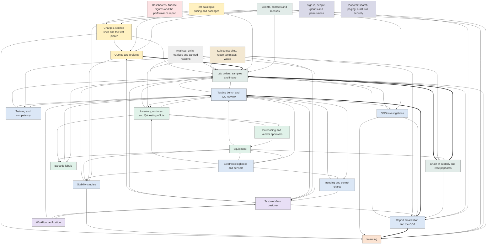

**Colours by menu section:** Home pink; Intake green-grey; Pricing yellow; Testing blue; Tests and workflows lilac; Lab supplies green; Billing orange; Master data grey; Lab setup sand; Platform slate. Arrows point the way information flows. Heavy arrows are the sample's path: quote, order, chain of custody, bench and QC Review, COA, invoice. Arrows into Dashboards and Platform are left out of the picture because every module feeds them; they are in the table below.

### Every connection

| From | To | What flows |
|---|---|---|
| Clients, contacts and licenses | Quotes and projects | quotes and projects are made for a client |
| Clients, contacts and licenses | Lab orders, samples and intake | orders take the client, its contacts and a license |
| Clients, contacts and licenses | Invoicing | billing contacts and payment terms |
| Clients, contacts and licenses | Report Finalization and the COA | report contacts receive the COA; On Hold blocks release |
| Clients, contacts and licenses | Charges, service lines and the test picker | client service lines and quoted charge prices |
| Clients, contacts and licenses | OOS investigations | report and quality contacts get the OOS email |
| Clients, contacts and licenses | Stability studies | stability quotes and studies are for a client |
| Lab orders, samples and intake | Chain of custody and receipt photos | submitting the order makes the chain of custody |
| Lab orders, samples and intake | Testing bench and QC Review | requested tests become the backlog |
| Lab orders, samples and intake | Report Finalization and the COA | samples get COAs |
| Lab orders, samples and intake | Invoicing | completed tests and order charges are billed |
| Lab orders, samples and intake | Barcode labels | sample labels with tests and due dates |
| Chain of custody and receipt photos | Lab orders, samples and intake | signed receipt logs the samples (sample IDs, Day 0) |
| Chain of custody and receipt photos | Report Finalization and the COA | photo report layouts print the receipt photos |
| Test catalogue, pricing and packages | Quotes and projects | list prices, packages and rush schedules on quote lines |
| Test catalogue, pricing and packages | Lab orders, samples and intake | list price for unquoted tests and serving tests |
| Test catalogue, pricing and packages | Invoicing | list price on invoice lines |
| Test catalogue, pricing and packages | Charges, service lines and the test picker | tests are placed under service line types |
| Quotes and projects | Lab orders, samples and intake | accepted quote lines are ordered at the quoted price, with their specifications |
| Quotes and projects | Stability studies | stability quotes use the same versions, sending and acceptance |
| Testing bench and QC Review | Report Finalization and the COA | approved results wait in Report Finalization |
| Testing bench and QC Review | OOS investigations | out-of-specification results open an OOS |
| Testing bench and QC Review | Trending and control charts | results and QC points are charted |
| Testing bench and QC Review | Training and competency | signed bench work counts toward competency |
| Testing bench and QC Review | Inventory, mixtures and QA testing of lots | lots used at the bench draw stock (Usage) |
| Testing bench and QC Review | Lab orders, samples and intake | order status In Testing, In Review, Approved; split-off tests ordered |
| Testing bench and QC Review | Barcode labels | batch labels |
| Testing bench and QC Review | Dashboards, finance figures and the performance report | work in progress, on time, my work |
| Report Finalization and the COA | Invoicing | a test is billable once its first COA is issued |
| Report Finalization and the COA | Dashboards, finance figures and the performance report | on time and turnaround |
| Report Finalization and the COA | Lab orders, samples and intake | order moves to Reported |
| OOS investigations | Report Finalization and the COA | held from release until concluded |
| OOS investigations | Invoicing | retests billable or not by QA determination |
| OOS investigations | Lab orders, samples and intake | retests are new requested tests on the sample |
| Stability studies | Lab orders, samples and intake | each pull becomes a lab order |
| Stability studies | Invoicing | billed per pull |
| Electronic logbooks and sensors | Testing bench and QC Review | logbook values in calculations; failing checks flag QC Review; aliquots scanned |
| Electronic logbooks and sensors | Stability studies | chamber temperature excursions |
| Electronic logbooks and sensors | Trending and control charts | logbook values charted |
| Electronic logbooks and sensors | Equipment | equipment page logbook and sensor cards |
| Electronic logbooks and sensors | Inventory, mixtures and QA testing of lots | inoculum and culture entries create lots |
| Trending and control charts | Testing bench and QC Review | approved QC charts in QC Review |
| Trending and control charts | Test workflow designer | frozen limits into a Draft test version |
| Trending and control charts | Dashboards, finance figures and the performance report | control charts to approve widget |
| Training and competency | Testing bench and QC Review | the training gate at bench steps |
| Training and competency | Lab orders, samples and intake | training samples (TRN-) on an internal order |
| Test workflow designer | Workflow verification | draft designs are verified |
| Test workflow designer | Testing bench and QC Review | approved versions run at the bench |
| Test workflow designer | Report Finalization and the COA | rounding, reporting and template drive the COA |
| Test workflow designer | Lab orders, samples and intake | requested tests are pinned to an effective version |
| Test workflow designer | Quotes and projects | specifications offer the suggested limits |
| Workflow verification | Test workflow designer | a passing verification opens approval (the gate) |
| Workflow verification | Testing bench and QC Review | runs real batches with VER- samples |
| Inventory, mixtures and QA testing of lots | Testing bench and QC Review | released lots used at bench steps (spikes, standards, media, strains) |
| Inventory, mixtures and QA testing of lots | Purchasing and vendor approvals | requests and reorders |
| Inventory, mixtures and QA testing of lots | Barcode labels | lot labels |
| Inventory, mixtures and QA testing of lots | Dashboards, finance figures and the performance report | low stock against demand |
| Inventory, mixtures and QA testing of lots | Lab orders, samples and intake | QA-testing samples (lot ID) on an internal order |
| Purchasing and vendor approvals | Inventory, mixtures and QA testing of lots | received items become lots |
| Purchasing and vendor approvals | Equipment | received equipment arrives tagged out for qualification |
| Equipment | Testing bench and QC Review | only usable, in-calibration equipment at bench steps |
| Equipment | Electronic logbooks and sensors | equipment checks and sensor entries |
| Equipment | Stability studies | chambers are equipment |
| Equipment | Barcode labels | equipment labels |
| Equipment | Chain of custody and receipt photos | receiving thermometers come from the register |
| Barcode labels | Platform: search, paging, audit trail, security | scanning a label into any search opens the record |
| Invoicing | Dashboards, finance figures and the performance report | revenue, billing and the performance report |
| Analytes, units, matrices and canned reasons | Test workflow designer | analytes, units and product categories in test designs |
| Analytes, units, matrices and canned reasons | Lab orders, samples and intake | matrix and compliance category on samples |
| Analytes, units, matrices and canned reasons | Inventory, mixtures and QA testing of lots | units and analytes on items |
| Analytes, units, matrices and canned reasons | Platform: search, paging, audit trail, security | canned reasons in every reason dialog |
| Lab setup: sites, report templates, waste | Lab orders, samples and intake | due dates use the lab calendar; sample IDs use the lab code |
| Lab setup: sites, report templates, waste | Report Finalization and the COA | templates, logos and accreditation on the COA |
| Lab setup: sites, report templates, waste | Inventory, mixtures and QA testing of lots | waste class on every lot |
| Lab setup: sites, report templates, waste | Test workflow designer | the verification gate |
| Lab setup: sites, report templates, waste | Chain of custody and receipt photos | the signed receipt switch |
| Lab setup: sites, report templates, waste | Training and competency | the training gate switch |
| Sign-in, people, groups and permissions | Platform: search, paging, audit trail, security | every request is checked against the session, the lab and the permission |
| Charges, service lines and the test picker | Lab orders, samples and intake | any test of the lab ordered at list price; charges on the order |
| Charges, service lines and the test picker | Quotes and projects | charges on quote versions |
| Charges, service lines and the test picker | Invoicing | order charges become invoice lines |

Every module also rests on **Sign-in, groups and permissions** (who may do what, in which lab) and on the **Platform** (audit trail on every change, search, paging, grids, security). Dashboards read from all of them.

## 1. Dashboards, finance figures and the performance report

**Section:** Home. Home widgets per group, the GM and executive dashboards, the weekly finance update and forecasts, the old start tiles page, and the Excel performance report with the raw data tabs.

**How it works:**
1. Each group gets its widgets (Admin › Dashboard widgets)
2. Live widgets refresh every 5 minutes; the others on Refresh (Home and dashboards)
3. Finance types weekly costs and monthly forecasts (Finance figures)
4. GM and executive dashboards compare labs and months
5. Performance report to Excel for a period, with raw data tabs

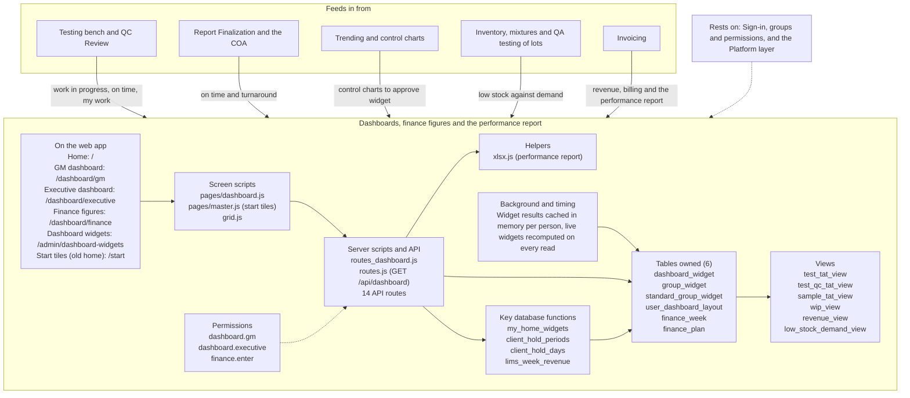

### Connections

| Direction | Module | What flows |
|---|---|---|
| In, from | Testing bench and QC Review | work in progress, on time, my work |
| In, from | Report Finalization and the COA | on time and turnaround |
| In, from | Trending and control charts | control charts to approve widget |
| In, from | Inventory, mixtures and QA testing of lots | low stock against demand |
| In, from | Invoicing | revenue, billing and the performance report |
| In, from | every module | dashboards read orders, tests, results, COAs, invoices, inventory and finance figures |
| Rests on | Sign-in, groups and permissions; Platform | session, lab and permission checks; audit trail; search; paging |

### Components

| Layer | Components |
|---|---|
| Pages on the web app | Home (`#/`); GM dashboard (`#/dashboard/gm`); Executive dashboard (`#/dashboard/executive`); Finance figures (`#/dashboard/finance`); Dashboard widgets (`#/admin/dashboard-widgets`); Start tiles (old home) (`#/start`) |
| Screen scripts | pages/dashboard.js; pages/master.js (start tiles); grid.js |
| Server scripts | routes_dashboard.js; routes.js (GET /api/dashboard) |
| Helpers | xlsx.js (performance report) |
| Background and timing | Widget results cached in memory per person; live widgets recomputed on every read |
| Migrations | `037_dashboards`, `038_dashboards_followup` |
| Tables owned (6) | `dashboard_widget` (037_dashboards), `group_widget` (037_dashboards), `standard_group_widget` (037_dashboards), `user_dashboard_layout` (037_dashboards), `finance_week` (037_dashboards), `finance_plan` (037_dashboards) |
| Key database functions | `my_home_widgets` (037_dashboards), `client_hold_periods` (037_dashboards), `client_hold_days` (037_dashboards), `lims_week_revenue` (038_dashboards_followup) |
| Views | `test_tat_view` (037_dashboards), `test_qc_tat_view` (038_dashboards_followup), `sample_tat_view` (038_dashboards_followup), `wip_view` (037_dashboards), `revenue_view` (037_dashboards), `low_stock_demand_view` (037_dashboards) |
| Permissions | `dashboard.gm`, `dashboard.executive`, `finance.enter` |
| Tests | `test_032_dashboards`, `test_033_dashboards_followup`, `e2e_dashboards`, `e2e_smoke` |

### API routes (14)

| Method | Path | Defined at |
|---|---|---|
| GET | `/api/dashboard/:board` | `routes_dashboard.js:374` |
| GET | `/api/dashboard/:board/detail` | `routes_dashboard.js:402` |
| PUT | `/api/dashboard/:board/layout` | `routes_dashboard.js:415` |
| POST | `/api/dashboard/:board/reset` | `routes_dashboard.js:424` |
| GET | `/api/departments` | `routes_dashboard.js:430` |
| GET | `/api/admin/dashboard-widgets` | `routes_dashboard.js:433` |
| POST | `/api/admin/dashboard-widgets` | `routes_dashboard.js:442` |
| GET | `/api/finance` | `routes_dashboard.js:461` |
| POST | `/api/finance/weeks` | `routes_dashboard.js:475` |
| POST | `/api/finance/plans` | `routes_dashboard.js:490` |
| GET | `/api/finance/plans.xlsx` | `routes_dashboard.js:508` |
| GET | `/api/finance/report.xlsx` | `routes_dashboard.js:534` |
| POST | `/api/finance/plans/preview` | `routes_dashboard.js:740` |
| GET | `/api/dashboard` | `routes.js:97` |

## 2. Clients, contacts and licenses

**Section:** Intake. The customers: status (Active, On Hold, Inactive), parent client, GMP flag, partial reports, payment terms, contacts with roles per client, and licenses that print on the COA.

**How it works:**
1. Create the client: status, GMP flag, partial reports (Intake › Clients › + New client)
2. Add contacts and their roles: Primary, Secondary, Ordering, Report, Billing, Quality, Alerts (client page › Contacts grid)
3. Record licenses with the scanned copy (client page › Licenses card)
4. Expiring and expired licenses are flagged (Intake › Client licenses)
5. On Hold blocks report release; Inactive blocks new orders

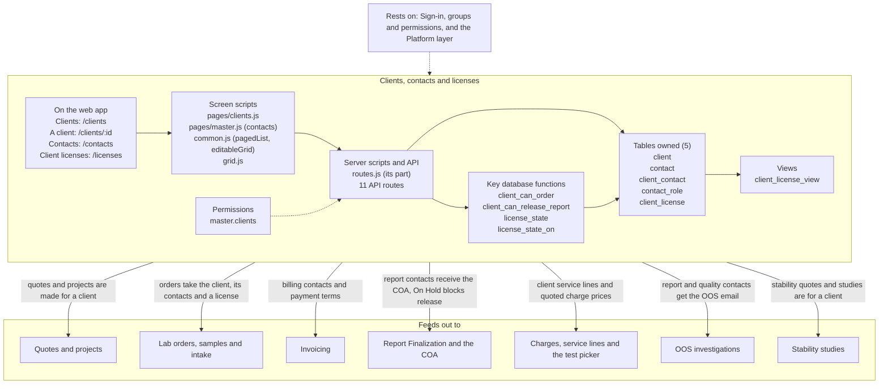

### Connections

| Direction | Module | What flows |
|---|---|---|
| Out, to | Quotes and projects | quotes and projects are made for a client |
| Out, to | Lab orders, samples and intake | orders take the client, its contacts and a license |
| Out, to | Invoicing | billing contacts and payment terms |
| Out, to | Report Finalization and the COA | report contacts receive the COA; On Hold blocks release |
| Out, to | Charges, service lines and the test picker | client service lines and quoted charge prices |
| Out, to | OOS investigations | report and quality contacts get the OOS email |
| Out, to | Stability studies | stability quotes and studies are for a client |
| Rests on | Sign-in, groups and permissions; Platform | session, lab and permission checks; audit trail; search; paging |

### Components

| Layer | Components |
|---|---|
| Pages on the web app | Clients (`#/clients`); A client (`#/clients/:id`); Contacts (`#/contacts`); Client licenses (`#/licenses`) |
| Screen scripts | pages/clients.js; pages/master.js (contacts); common.js (pagedList, editableGrid); grid.js |
| Server scripts | routes.js (its part) |
| Migrations | `001_core_client_contact_analyte`, `055_dept_training_metrc_licenses` |
| Tables owned (5) | `client` (001_core_client_contact_analyte), `contact` (001_core_client_contact_analyte), `client_contact` (001_core_client_contact_analyte), `contact_role` (001_core_client_contact_analyte), `client_license` (055_dept_training_metrc_licenses) |
| Key database functions | `client_can_order` (001_core_client_contact_analyte), `client_can_release_report` (001_core_client_contact_analyte), `license_state` (055_dept_training_metrc_licenses), `license_state_on` (057_cancel_thermometer) |
| Views | `client_license_view` (055_dept_training_metrc_licenses) |
| Permissions | `master.clients` |
| Tests | `test_001_core`, `test_048_dept_training_metrc_licenses`, `e2e_smoke`, `e2e_licenses` |

### API routes (11)

| Method | Path | Defined at |
|---|---|---|
| GET | `/api/clients` | `routes.js:113` |
| GET | `/api/clients/:id` | `routes.js:119` |
| POST | `/api/clients/:id/licenses` | `routes.js:148` |
| PUT | `/api/licenses/:id` | `routes.js:159` |
| GET | `/api/licenses/:id/file` | `routes.js:171` |
| GET | `/api/licenses` | `routes.js:178` |
| POST | `/api/clients` | `routes.js:187` |
| PUT | `/api/clients/:id` | `routes.js:188` |
| GET | `/api/contacts` | `routes.js:194` |
| POST | `/api/contacts/bulk` | `routes.js:199` |
| POST | `/api/client-contacts/bulk` | `routes.js:200` |

## 3. Lab orders, samples and intake

**Section:** Intake. The order and its samples: tests from accepted quotes or at list price, packages, rush per test, serving sizes, METRC IDs, logging (sample IDs, Day 0, due dates), cancelling, the intake dashboard and the Outbox.

**How it works:**
1. New lab order for a client (Intake › Lab orders › + New)
2. Samples by paste and fill down; apply a project, add tests or a package (order page › samples grid)
3. Rush per test; approval-required tiers wait on the intake dashboard
4. Receive and log: sample IDs SITEyymmdd###, Day 0, due dates on the lab calendar
5. Requested tests enter the backlog
6. Order status follows the work: Draft, Submitted, Received, In Testing, In Review, Approved, Reported
7. Automatic emails wait in the Outbox

```mermaid
flowchart TB
  subgraph IN["Feeds in from"]
    direction LR
    in0["Clients, contacts and licenses"]
    in1["Chain of custody and receipt photos"]
    in2["Test catalogue, pricing and packages"]
    in3["Quotes and projects"]
    in4["Testing bench and QC Review"]
    in5["Report Finalization and the COA"]
    in6["OOS investigations"]
    in7["Stability studies"]
    in8["Training and competency"]
    in9["Test workflow designer"]
    in10["Inventory, mixtures and QA testing of lots"]
    in11["Analytes, units, matrices and canned reasons"]
    in12["Lab setup: sites, report templates, waste"]
    in13["Charges, service lines and the test picker"]
  end
  subgraph MOD["Lab orders, samples and intake"]
    direction LR
    UI["On the web app<br/>Lab orders: /orders<br/>An order: /orders/:id<br/>A sample: /samples/:id<br/>Intake dashboard: /intake<br/>Outbox: /outbox"]
    SC["Screen scripts<br/>pages/orders.js<br/>pages/intake.js<br/>common.js<br/>grid.js<br/>combo.js"]
    SV["Server scripts and API<br/>routes.js (its part)<br/>19 API routes"]
    DBT["Tables owned (8)<br/>lab_order<br/>sample<br/>requested_test<br/>requested_analyte<br/>rush_decision<br/>email_outbox<br/>site_day_counter<br/>ordered_package"]
    DBF["Key database functions<br/>requested_test_derive<br/>order_test<br/>apply_project<br/>log_samples<br/>refresh_order_status<br/>queue_email<br/>order_serving_test<br/>request_serving_test<br/>requested_test_cancel_problem<br/>order_package<br/>cancel_ordered_package"]
    DBV["Views<br/>lab_order_view<br/>sample_view<br/>requested_test_view"]
    PM["Permissions<br/>orders.edit<br/>intake.rush"]
    UI --> SC --> SV
    SV --> DBT
    SV --> DBF --> DBT
    DBT --> DBV
    PM -.-> SV
  end
  subgraph OUTG["Feeds out to"]
    direction LR
    out0["Chain of custody and receipt photos"]
    out1["Testing bench and QC Review"]
    out2["Report Finalization and the COA"]
    out3["Invoicing"]
    out4["Barcode labels"]
  end
  in0 -->|"orders take the client, its contacts and a license"| MOD
  in1 -->|"signed receipt logs the samples (sample IDs, Day 0)"| MOD
  in2 -->|"list price for unquoted tests and serving tests"| MOD
  in3 -->|"accepted quote lines are ordered at the quoted price, with their specifications"| MOD
  in4 -->|"order status In Testing, In Review, Approved, split-off tests ordered"| MOD
  in5 -->|"order moves to Reported"| MOD
  in6 -->|"retests are new requested tests on the sample"| MOD
  in7 -->|"each pull becomes a lab order"| MOD
  in8 -->|"training samples (TRN-) on an internal order"| MOD
  in9 -->|"requested tests are pinned to an effective version"| MOD
  in10 -->|"QA-testing samples (lot ID) on an internal order"| MOD
  in11 -->|"matrix and compliance category on samples"| MOD
  in12 -->|"due dates use the lab calendar, sample IDs use the lab code"| MOD
  in13 -->|"any test of the lab ordered at list price, charges on the order"| MOD
  MOD -->|"submitting the order makes the chain of custody"| out0
  MOD -->|"requested tests become the backlog"| out1
  MOD -->|"samples get COAs"| out2
  MOD -->|"completed tests and order charges are billed"| out3
  MOD -->|"sample labels with tests and due dates"| out4
  FD["Rests on: Sign-in, groups and permissions, and the Platform layer"]
  FD -.-> MOD
```

### Connections

| Direction | Module | What flows |
|---|---|---|
| In, from | Clients, contacts and licenses | orders take the client, its contacts and a license |
| In, from | Chain of custody and receipt photos | signed receipt logs the samples (sample IDs, Day 0) |
| In, from | Test catalogue, pricing and packages | list price for unquoted tests and serving tests |
| In, from | Quotes and projects | accepted quote lines are ordered at the quoted price, with their specifications |
| In, from | Testing bench and QC Review | order status In Testing, In Review, Approved; split-off tests ordered |
| In, from | Report Finalization and the COA | order moves to Reported |
| In, from | OOS investigations | retests are new requested tests on the sample |
| In, from | Stability studies | each pull becomes a lab order |
| In, from | Training and competency | training samples (TRN-) on an internal order |
| In, from | Test workflow designer | requested tests are pinned to an effective version |
| In, from | Inventory, mixtures and QA testing of lots | QA-testing samples (lot ID) on an internal order |
| In, from | Analytes, units, matrices and canned reasons | matrix and compliance category on samples |
| In, from | Lab setup: sites, report templates, waste | due dates use the lab calendar; sample IDs use the lab code |
| In, from | Charges, service lines and the test picker | any test of the lab ordered at list price; charges on the order |
| Out, to | Chain of custody and receipt photos | submitting the order makes the chain of custody |
| Out, to | Testing bench and QC Review | requested tests become the backlog |
| Out, to | Report Finalization and the COA | samples get COAs |
| Out, to | Invoicing | completed tests and order charges are billed |
| Out, to | Barcode labels | sample labels with tests and due dates |
| Rests on | Sign-in, groups and permissions; Platform | session, lab and permission checks; audit trail; search; paging |

### Components

| Layer | Components |
|---|---|
| Pages on the web app | Lab orders (`#/orders`); An order (`#/orders/:id`); A sample (`#/samples/:id`); Intake dashboard (`#/intake`); Outbox (`#/outbox`) |
| Screen scripts | pages/orders.js; pages/intake.js; common.js; grid.js; combo.js |
| Server scripts | routes.js (its part) |
| Migrations | `003_sites_orders_samples`, `004_lab_access_matrix_tat_override`, `031_quote_pricing_serving`, `033_serving_measurement`, `047_packages_price_changes`, `055_dept_training_metrc_licenses`, `057_cancel_thermometer` |
| Tables owned (8) | `lab_order` (003_sites_orders_samples), `sample` (003_sites_orders_samples), `requested_test` (003_sites_orders_samples), `requested_analyte` (003_sites_orders_samples), `rush_decision` (003_sites_orders_samples), `email_outbox` (003_sites_orders_samples), `site_day_counter` (003_sites_orders_samples), `ordered_package` (047_packages_price_changes) |
| Key database functions | `requested_test_derive` (003_sites_orders_samples; replaced in 004_lab_access_matrix_tat_override, 023_media_purchasing_batch_edits, 033_serving_measurement, 058_charges_service_lines_catalogue_orders), `order_test` (003_sites_orders_samples), `apply_project` (003_sites_orders_samples; replaced in 031_quote_pricing_serving, 047_packages_price_changes), `log_samples` (003_sites_orders_samples; replaced in 004_lab_access_matrix_tat_override), `refresh_order_status` (018_qc_review; replaced in 021_runs_preliminary_results, 023_media_purchasing_batch_edits, 027_oos_investigations), `queue_email` (026_result_finalization_coa; replaced in 027_oos_investigations), `order_serving_test` (033_serving_measurement), `request_serving_test` (033_serving_measurement), `requested_test_cancel_problem` (057_cancel_thermometer), `order_package` (047_packages_price_changes), `cancel_ordered_package` (047_packages_price_changes) |
| Views | `lab_order_view` (003_sites_orders_samples), `sample_view` (003_sites_orders_samples), `requested_test_view` (003_sites_orders_samples) |
| Permissions | `orders.edit`, `intake.rush` |
| Tests | `test_003_orders_samples`, `test_004_access_matrix_tat`, `test_028_serving_measurement`, `test_050_cancel_thermometer`, `e2e_slice2`, `e2e_slice2_1`, `e2e_cancel_thermometer`, `e2e_serving` |

### API routes (19)

| Method | Path | Defined at |
|---|---|---|
| GET | `/api/orders` | `routes.js:486` |
| POST | `/api/orders` | `routes.js:497` |
| PUT | `/api/orders/:id` | `routes.js:501` |
| GET | `/api/orders/:id` | `routes.js:502` |
| GET | `/api/samples/:id` | `routes.js:534` |
| GET | `/api/order-setup/:clientId` | `routes.js:551` |
| POST | `/api/orders/:id/samples` | `routes.js:556` |
| POST | `/api/samples/:id/serving-request` | `routes.js:561` |
| POST | `/api/orders/:id/apply-project` | `routes.js:584` |
| POST | `/api/orders/:id/add-test` | `routes.js:587` |
| POST | `/api/orders/:id/tests` | `routes.js:596` |
| POST | `/api/orders/:id/rush` | `routes.js:597` |
| POST | `/api/orders/:id/log` | `routes.js:607` |
| POST | `/api/orders/:id/cancel` | `routes.js:610` |
| GET | `/api/requested-tests/:id/analytes` | `routes.js:632` |
| POST | `/api/requested-tests/:id/analytes` | `routes.js:640` |
| GET | `/api/intake` | `routes.js:642` |
| POST | `/api/rush-decisions` | `routes.js:661` |
| GET | `/api/outbox` | `routes.js:667` |

## 4. Chain of custody and receipt photos

**Section:** Intake. One document per order that is both the manifest and the chain of custody, signed at receipt with courier, tracking, temperature, thermometer, condition and seals; receipt photos cropped 4:3 for photo reports.

**How it works:**
1. Order submitted: chain of custody made (COC-<order>), automatically by the z_custody trigger
2. Receive and sign: courier, tracking, temperature, thermometer, seals (order page › Receive and sign)
3. Signed receipt PDF kept with its SHA-256 fingerprint and QR code
4. Paper copy signed by the client attached (Chain of custody card)
5. Photos at receipt, report places 1 and 2 (sample page › Photos card)

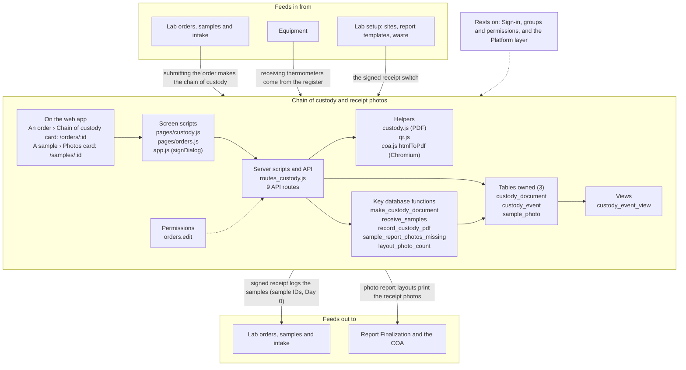

### Connections

| Direction | Module | What flows |
|---|---|---|
| In, from | Lab orders, samples and intake | submitting the order makes the chain of custody |
| In, from | Equipment | receiving thermometers come from the register |
| In, from | Lab setup: sites, report templates, waste | the signed receipt switch |
| Out, to | Lab orders, samples and intake | signed receipt logs the samples (sample IDs, Day 0) |
| Out, to | Report Finalization and the COA | photo report layouts print the receipt photos |
| Rests on | Sign-in, groups and permissions; Platform | session, lab and permission checks; audit trail; search; paging |

### Components

| Layer | Components |
|---|---|
| Pages on the web app | An order › Chain of custody card (`#/orders/:id`); A sample › Photos card (`#/samples/:id`) |
| Screen scripts | pages/custody.js; pages/orders.js; app.js (signDialog) |
| Server scripts | routes_custody.js |
| Helpers | custody.js (PDF); qr.js; coa.js htmlToPdf (Chromium) |
| Migrations | `051_custody_photos_qr`, `057_cancel_thermometer` |
| Tables owned (3) | `custody_document` (051_custody_photos_qr), `custody_event` (051_custody_photos_qr), `sample_photo` (051_custody_photos_qr) |
| Key database functions | `make_custody_document` (051_custody_photos_qr), `receive_samples` (051_custody_photos_qr; replaced in 057_cancel_thermometer), `record_custody_pdf` (051_custody_photos_qr), `sample_report_photos_missing` (051_custody_photos_qr), `layout_photo_count` (051_custody_photos_qr) |
| Views | `custody_event_view` (051_custody_photos_qr) |
| Permissions | `orders.edit` |
| Tests | `test_044_custody_photos`, `test_050_cancel_thermometer`, `e2e_custody`, `e2e_cancel_thermometer` |

### API routes (9)

| Method | Path | Defined at |
|---|---|---|
| GET | `/api/orders/:id/custody` | `routes_custody.js:25` |
| GET | `/api/orders/:id/custody.pdf` | `routes_custody.js:38` |
| POST | `/api/orders/:id/receive` | `routes_custody.js:47` |
| GET | `/api/custody/events/:id/file` | `routes_custody.js:68` |
| POST | `/api/orders/:id/custody/paper` | `routes_custody.js:78` |
| GET | `/api/samples/:id/photos` | `routes_custody.js:96` |
| POST | `/api/samples/:id/photos` | `routes_custody.js:103` |
| PUT | `/api/photos/:id` | `routes_custody.js:130` |
| GET | `/api/photos/:id/file` | `routes_custody.js:145` |

## 5. Test catalogue, pricing and packages

**Section:** Pricing. What the lab sells: each test's price, pricing mode, TAT, cutoff and rush schedule; packages of tests priced test by test; dated price changes; the subcontract 20-30 rule.

**How it works:**
1. Set a test's price, pricing mode, TAT and cutoff (Test catalogue › test editor)
2. Attach a rush fee schedule (Pricing › Rush fee schedules)
3. Build a package: type each test's package price (Test catalogue › Packages tab)
4. Schedule a price change by % from a date (Test catalogue › Price changes tab)
5. Hourly job applies due price changes (routes_packages.js applyDue)

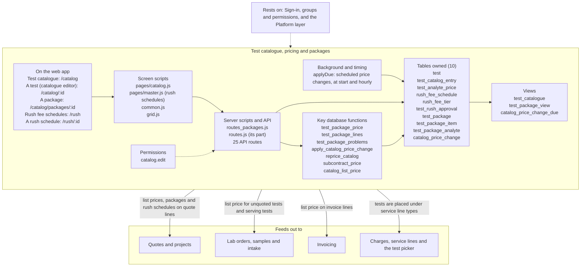

### Connections

| Direction | Module | What flows |
|---|---|---|
| Out, to | Quotes and projects | list prices, packages and rush schedules on quote lines |
| Out, to | Lab orders, samples and intake | list price for unquoted tests and serving tests |
| Out, to | Invoicing | list price on invoice lines |
| Out, to | Charges, service lines and the test picker | tests are placed under service line types |
| Rests on | Sign-in, groups and permissions; Platform | session, lab and permission checks; audit trail; search; paging |

### Components

| Layer | Components |
|---|---|
| Pages on the web app | Test catalogue (`#/catalog`); A test (catalogue editor) (`#/catalog/:id`); A package (`#/catalog/packages/:id`); Rush fee schedules (`#/rush`); A rush schedule (`#/rush/:id`) |
| Screen scripts | pages/catalog.js; pages/master.js (rush schedules); common.js; grid.js |
| Server scripts | routes_packages.js; routes.js (its part) |
| Background and timing | applyDue: scheduled price changes, at start and hourly |
| Migrations | `002_catalog_pricing_projects`, `031_quote_pricing_serving`, `047_packages_price_changes`, `049_package_test_prices` |
| Tables owned (10) | `test` (002_catalog_pricing_projects), `test_catalog_entry` (002_catalog_pricing_projects), `test_analyte_price` (002_catalog_pricing_projects), `rush_fee_schedule` (002_catalog_pricing_projects), `rush_fee_tier` (002_catalog_pricing_projects), `test_rush_approval` (002_catalog_pricing_projects), `test_package` (047_packages_price_changes), `test_package_item` (047_packages_price_changes), `test_package_analyte` (047_packages_price_changes), `catalog_price_change` (047_packages_price_changes) |
| Key database functions | `test_package_price` (047_packages_price_changes; replaced in 049_package_test_prices), `test_package_lines` (047_packages_price_changes; replaced in 049_package_test_prices), `test_package_problems` (047_packages_price_changes; replaced in 049_package_test_prices), `apply_catalog_price_change` (047_packages_price_changes; replaced in 049_package_test_prices), `reprice_catalog` (031_quote_pricing_serving), `subcontract_price` (031_quote_pricing_serving), `catalog_list_price` (002_catalog_pricing_projects) |
| Views | `test_catalogue` (002_catalog_pricing_projects), `test_package_view` (047_packages_price_changes), `catalog_price_change_due` (047_packages_price_changes) |
| Permissions | `catalog.edit` |
| Tests | `test_002_catalog_projects`, `test_026_quote_pricing_serving`, `test_041_packages`, `e2e_pricing`, `e2e_packages` |

### API routes (25)

| Method | Path | Defined at |
|---|---|---|
| GET | `/api/packages` | `routes_packages.js:10` |
| GET | `/api/packages/options` | `routes_packages.js:16` |
| GET | `/api/packages/:id` | `routes_packages.js:29` |
| POST | `/api/packages` | `routes_packages.js:47` |
| PUT | `/api/packages/:id` | `routes_packages.js:59` |
| POST | `/api/packages/:id/retire` | `routes_packages.js:84` |
| GET | `/api/versions/:vid/packages` | `routes_packages.js:97` |
| POST | `/api/versions/:vid/packages` | `routes_packages.js:113` |
| PUT | `/api/quoted-packages/:id` | `routes_packages.js:119` |
| POST | `/api/quoted-packages/:id/remove` | `routes_packages.js:124` |
| POST | `/api/orders/:id/add-package` | `routes_packages.js:130` |
| GET | `/api/requested-tests/:id/package-cancel` | `routes_packages.js:144` |
| POST | `/api/ordered-packages/:id/cancel` | `routes_packages.js:151` |
| GET | `/api/price-changes` | `routes_packages.js:160` |
| POST | `/api/price-changes` | `routes_packages.js:170` |
| POST | `/api/price-changes/:id/cancel` | `routes_packages.js:188` |
| GET | `/api/rush-schedules` | `routes.js:217` |
| POST | `/api/rush-schedules/bulk` | `routes.js:223` |
| POST | `/api/rush-schedules/:id/tiers/bulk` | `routes.js:224` |
| GET | `/api/catalog` | `routes.js:229` |
| GET | `/api/catalog.csv` | `routes.js:230` |
| POST | `/api/tests` | `routes.js:241` |
| POST | `/api/catalog/reprice` | `routes.js:243` |
| GET | `/api/catalog/:testId` | `routes.js:250` |
| PUT | `/api/catalog/:testId` | `routes.js:267` |

## 6. Quotes and projects

**Section:** Pricing. One-off quotes (Q-) and reusable projects (PRJ-): versioned, discounted by % per line, with packages, charges, specifications and rush terms, sent to the client as a PDF with an accept link. Accepted lines set the client price.

**How it works:**
1. New quote for a client; pick tests from each lab (Pricing › Quotes › + New quote)
2. Discounts, specifications, rush terms; subcontracted tests at the 20-30 rule (quote lines grid)
3. Issue and send: PDF and email to the contact (Send to client…, Outbox)
4. Client accepts or declines online (public quote-response page)
5. Accepted lines become orderable at the quoted price (orderable_lines)

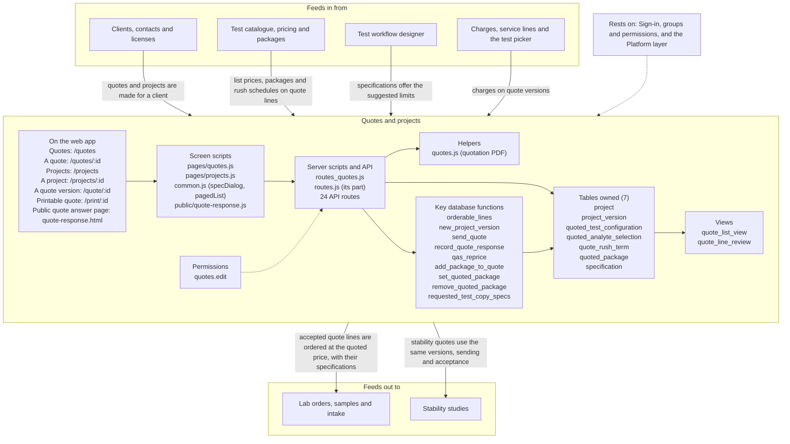

### Connections

| Direction | Module | What flows |
|---|---|---|
| In, from | Clients, contacts and licenses | quotes and projects are made for a client |
| In, from | Test catalogue, pricing and packages | list prices, packages and rush schedules on quote lines |
| In, from | Test workflow designer | specifications offer the suggested limits |
| In, from | Charges, service lines and the test picker | charges on quote versions |
| Out, to | Lab orders, samples and intake | accepted quote lines are ordered at the quoted price, with their specifications |
| Out, to | Stability studies | stability quotes use the same versions, sending and acceptance |
| Rests on | Sign-in, groups and permissions; Platform | session, lab and permission checks; audit trail; search; paging |

### Components

| Layer | Components |
|---|---|
| Pages on the web app | Quotes (`#/quotes`); A quote (`#/quotes/:id`); Projects (`#/projects`); A project (`#/projects/:id`); A quote version (`#/quote/:id`); Printable quote (`#/print/:id`); Public quote answer page (`quote-response.html`) |
| Screen scripts | pages/quotes.js; pages/projects.js; common.js (specDialog, pagedList); public/quote-response.js |
| Server scripts | routes_quotes.js; routes.js (its part) |
| Helpers | quotes.js (quotation PDF) |
| Migrations | `002_catalog_pricing_projects`, `029_standalone_quotes`, `031_quote_pricing_serving`, `047_packages_price_changes` |
| Tables owned (7) | `project` (002_catalog_pricing_projects), `project_version` (002_catalog_pricing_projects), `quoted_test_configuration` (002_catalog_pricing_projects), `quoted_analyte_selection` (002_catalog_pricing_projects), `quote_rush_term` (002_catalog_pricing_projects), `quoted_package` (047_packages_price_changes), `specification` (012_workflow_designer) |
| Key database functions | `orderable_lines` (002_catalog_pricing_projects; replaced in 032_stability_studies, 047_packages_price_changes), `new_project_version` (002_catalog_pricing_projects; replaced in 012_workflow_designer, 031_quote_pricing_serving, 047_packages_price_changes), `send_quote` (029_standalone_quotes), `record_quote_response` (029_standalone_quotes), `qas_reprice` (002_catalog_pricing_projects; replaced in 031_quote_pricing_serving), `add_package_to_quote` (047_packages_price_changes), `set_quoted_package` (047_packages_price_changes), `remove_quoted_package` (047_packages_price_changes), `requested_test_copy_specs` (012_workflow_designer; replaced in 031_quote_pricing_serving) |
| Views | `quote_list_view` (029_standalone_quotes), `quote_line_review` (002_catalog_pricing_projects) |
| Permissions | `quotes.edit` |
| Tests | `test_002_catalog_projects`, `test_024_quotes`, `test_026_quote_pricing_serving`, `e2e_quotes`, `e2e_pricing`, `e2e_slice2` |

### API routes (24)

| Method | Path | Defined at |
|---|---|---|
| GET | `/api/quotes` | `routes_quotes.js:21` |
| POST | `/api/quotes` | `routes_quotes.js:43` |
| PUT | `/api/quotes/:id` | `routes_quotes.js:52` |
| GET | `/api/quotes/people` | `routes_quotes.js:59` |
| GET | `/api/quotes/catalog` | `routes_quotes.js:65` |
| POST | `/api/quotes/versions/:vid/send` | `routes_quotes.js:78` |
| POST | `/api/quotes/versions/:vid/decide` | `routes_quotes.js:96` |
| GET | `/api/quotes/versions/:vid/pdf` | `routes_quotes.js:110` |
| GET | `/api/public/quote/:token` | `routes_quotes.js:119` |
| GET | `/api/public/quote/:token/pdf` | `routes_quotes.js:133` |
| POST | `/api/public/quote/:token` | `routes_quotes.js:139` |
| GET | `/api/projects` | `routes.js:288` |
| POST | `/api/projects` | `routes.js:293` |
| PUT | `/api/projects/:id` | `routes.js:298` |
| GET | `/api/projects/:id` | `routes.js:300` |
| POST | `/api/projects/:id/versions` | `routes.js:308` |
| GET | `/api/versions/:vid` | `routes.js:310` |
| PUT | `/api/versions/:vid` | `routes.js:329` |
| POST | `/api/versions/:vid/status` | `routes.js:330` |
| POST | `/api/versions/:vid/lines` | `routes.js:333` |
| POST | `/api/versions/:vid/rush-terms` | `routes.js:341` |
| GET | `/api/lines/:lineId/analytes` | `routes.js:342` |
| POST | `/api/lines/:lineId/analytes` | `routes.js:344` |
| POST | `/api/versions/:vid/serving-line` | `routes.js:570` |

## 7. Testing bench and QC Review

**Section:** Testing. From backlog to approved results: batches with QC, bench steps (weigh, prepare, dilute, read, incubate, plate, split off, hold point, calculate), analytical runs, re-preps, timepoint releases, and the reviewer's step approvals and signed batch approval.

**How it works:**
1. Backlog by department: re-preps first, then rush, then due date (Testing › Backlog)
2. Autobatch with QC, or batch selected rows
3. Bench steps, each signed Performed by (witness when the step requires it)
4. Live results and QC verdicts per analyte (Results and QC tabs)
5. Reviewer approves each step, then the batch (signed Reviewed by) in QC Review
6. Results stored and compared with the specification; order status moves
7. Re-analysis (new run) or re-prep (back to the backlog) when needed; return to the analyst from review

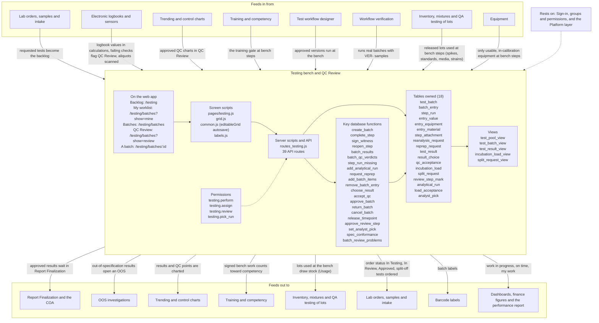

### Connections

| Direction | Module | What flows |
|---|---|---|
| In, from | Lab orders, samples and intake | requested tests become the backlog |
| In, from | Electronic logbooks and sensors | logbook values in calculations; failing checks flag QC Review; aliquots scanned |
| In, from | Trending and control charts | approved QC charts in QC Review |
| In, from | Training and competency | the training gate at bench steps |
| In, from | Test workflow designer | approved versions run at the bench |
| In, from | Workflow verification | runs real batches with VER- samples |
| In, from | Inventory, mixtures and QA testing of lots | released lots used at bench steps (spikes, standards, media, strains) |
| In, from | Equipment | only usable, in-calibration equipment at bench steps |
| Out, to | Report Finalization and the COA | approved results wait in Report Finalization |
| Out, to | OOS investigations | out-of-specification results open an OOS |
| Out, to | Trending and control charts | results and QC points are charted |
| Out, to | Training and competency | signed bench work counts toward competency |
| Out, to | Inventory, mixtures and QA testing of lots | lots used at the bench draw stock (Usage) |
| Out, to | Lab orders, samples and intake | order status In Testing, In Review, Approved; split-off tests ordered |
| Out, to | Barcode labels | batch labels |
| Out, to | Dashboards, finance figures and the performance report | work in progress, on time, my work |
| Rests on | Sign-in, groups and permissions; Platform | session, lab and permission checks; audit trail; search; paging |

### Components

| Layer | Components |
|---|---|
| Pages on the web app | Backlog (`#/testing`); My worklist (`#/testing/batches?show=mine`); Batches (`#/testing/batches`); QC Review (`#/testing/batches?show=review`); A batch (`#/testing/batches/:id`) |
| Screen scripts | pages/testing.js; grid.js; common.js (editableGrid autosave); labels.js |
| Server scripts | routes_testing.js |
| Migrations | `016_test_execution`, `017_bench_stock_usage`, `018_qc_review`, `019_micro_bench`, `020_review_step_marks`, `021_runs_preliminary_results`, `022_spike_basis_load_acceptance`, `033_serving_measurement`, `035_logbook_values_feed_results`, `039_matrix_bench_alerts_invalid_readings`, `042_zero_count_controls`, `048_run_dilutions_analyst_pick` |
| Tables owned (18) | `test_batch` (016_test_execution), `batch_entry` (016_test_execution), `step_run` (016_test_execution), `entry_value` (016_test_execution), `entry_equipment` (016_test_execution), `entry_material` (016_test_execution), `step_attachment` (016_test_execution), `reanalysis_request` (016_test_execution), `reprep_request` (016_test_execution), `test_result` (018_qc_review), `result_choice` (018_qc_review), `qc_acceptance` (018_qc_review), `incubation_load` (019_micro_bench), `split_request` (019_micro_bench), `review_step_mark` (020_review_step_marks), `analytical_run` (021_runs_preliminary_results), `load_acceptance` (022_spike_basis_load_acceptance), `analyst_pick` (048_run_dilutions_analyst_pick) |
| Key database functions | `create_batch` (016_test_execution; replaced in 019_micro_bench, 021_runs_preliminary_results, 023_media_purchasing_batch_edits, 024_workflow_verification), `complete_step` (016_test_execution), `sign_witness` (016_test_execution), `reopen_step` (016_test_execution; replaced in 021_runs_preliminary_results), `batch_results` (016_test_execution; replaced in 018_qc_review, 019_micro_bench, 021_runs_preliminary_results, 033_serving_measurement, 035_logbook_values_feed_results, 048_run_dilutions_analyst_pick), `batch_qc_verdicts` (016_test_execution; replaced in 019_micro_bench, 021_runs_preliminary_results, 022_spike_basis_load_acceptance, 039_matrix_bench_alerts_invalid_readings, 042_zero_count_controls), `step_run_missing` (016_test_execution; replaced in 019_micro_bench, 021_runs_preliminary_results, 033_serving_measurement, 039_matrix_bench_alerts_invalid_readings, 042_zero_count_controls), `add_analytical_run` (021_runs_preliminary_results), `request_reprep` (016_test_execution), `add_batch_items` (023_media_purchasing_batch_edits), `remove_batch_entry` (023_media_purchasing_batch_edits), `choose_result` (018_qc_review; replaced in 021_runs_preliminary_results, 039_matrix_bench_alerts_invalid_readings), `accept_qc` (018_qc_review; replaced in 021_runs_preliminary_results), `approve_batch` (018_qc_review; replaced in 021_runs_preliminary_results), `return_batch` (018_qc_review; replaced in 021_runs_preliminary_results), `cancel_batch` (018_qc_review; replaced in 021_runs_preliminary_results), `release_timepoint` (021_runs_preliminary_results), `approve_review_step` (020_review_step_marks; replaced in 021_runs_preliminary_results), `set_analyst_pick` (048_run_dilutions_analyst_pick), `spec_conformance` (018_qc_review; replaced in 031_quote_pricing_serving, 033_serving_measurement), `batch_review_problems` (018_qc_review; replaced in 020_review_step_marks, 021_runs_preliminary_results, 022_spike_basis_load_acceptance, 034_logbooks, 035_logbook_values_feed_results, 039_matrix_bench_alerts_invalid_readings) |
| Views | `test_pool_view` (016_test_execution), `test_batch_view` (016_test_execution), `test_result_view` (018_qc_review), `incubation_load_view` (019_micro_bench), `split_request_view` (019_micro_bench) |
| Permissions | `testing.perform`, `testing.assign`, `testing.review`, `testing.pick_run` |
| Tests | `test_015_execution`, `test_016_qc_review`, `test_017_micro_bench`, `test_018_runs_preliminary`, `test_019_spike_basis`, `test_034_matrix_bench_alerts`, `test_042_run_dilution_pick`, `e2e_testing`, `e2e_micro`, `e2e_wd5`, `e2e_bench_runs`, `e2e_bax` |

### API routes (39)

| Method | Path | Defined at |
|---|---|---|
| GET | `/api/testing/backlog` | `routes_testing.js:58` |
| POST | `/api/testing/batches` | `routes_testing.js:68` |
| GET | `/api/testing/batches` | `routes_testing.js:77` |
| GET | `/api/testing/batches/:id` | `routes_testing.js:99` |
| GET | `/api/testing/batches/:id/options` | `routes_testing.js:182` |
| GET | `/api/testing/batches/:id/pool` | `routes_testing.js:210` |
| POST | `/api/testing/batches/:id/add` | `routes_testing.js:217` |
| POST | `/api/testing/entries/:id/remove` | `routes_testing.js:224` |
| GET | `/api/testing/open-batches` | `routes_testing.js:232` |
| POST | `/api/testing/step-runs/:id/values` | `routes_testing.js:241` |
| POST | `/api/testing/step-runs/:id/fields` | `routes_testing.js:267` |
| POST | `/api/testing/step-runs/:id/equipment` | `routes_testing.js:273` |
| POST | `/api/testing/step-runs/:id/materials` | `routes_testing.js:287` |
| POST | `/api/testing/used/:kind/:id/remove` | `routes_testing.js:300` |
| POST | `/api/testing/step-runs/:id/attachments` | `routes_testing.js:308` |
| GET | `/api/testing/attachments/:id/file` | `routes_testing.js:319` |
| POST | `/api/testing/entries/:id/parent` | `routes_testing.js:329` |
| POST | `/api/testing/step-runs/:id/loads` | `routes_testing.js:339` |
| POST | `/api/testing/loads/:id` | `routes_testing.js:346` |
| GET | `/api/testing/split-requests` | `routes_testing.js:362` |
| POST | `/api/testing/split-requests/:id/decide` | `routes_testing.js:368` |
| POST | `/api/testing/step-runs/:id/complete` | `routes_testing.js:394` |
| POST | `/api/testing/step-runs/:id/reopen` | `routes_testing.js:405` |
| POST | `/api/testing/step-runs/:id/reanalysis` | `routes_testing.js:410` |
| POST | `/api/testing/step-runs/:id/runs` | `routes_testing.js:420` |
| POST | `/api/testing/entries/:id/pick` | `routes_testing.js:434` |
| POST | `/api/testing/picks/:id/clear` | `routes_testing.js:444` |
| POST | `/api/testing/batches/:id/reprep` | `routes_testing.js:451` |
| POST | `/api/testing/batches/:id/assign` | `routes_testing.js:460` |
| GET | `/api/testing/batches/:id/review` | `routes_testing.js:467` |
| POST | `/api/testing/batches/:id/choose` | `routes_testing.js:513` |
| POST | `/api/testing/batches/:id/accept-qc` | `routes_testing.js:527` |
| POST | `/api/testing/batches/:id/accept-load` | `routes_testing.js:536` |
| POST | `/api/testing/batches/:id/steps/:runId/review-mark` | `routes_testing.js:545` |
| POST | `/api/testing/batches/:id/approve` | `routes_testing.js:556` |
| POST | `/api/testing/batches/:id/timepoints/:runId/release` | `routes_testing.js:562` |
| POST | `/api/testing/batches/:id/return` | `routes_testing.js:570` |
| POST | `/api/testing/batches/:id/cancel` | `routes_testing.js:576` |
| GET | `/api/testing/samples/:id/results` | `routes_testing.js:582` |

## 8. Report Finalization and the COA

**Section:** Testing. The second review: claimed, checked against the release rules, signed and issued as a PDF COA with a verification code and QR, versioned and hash-chained, emailed to the client's report contacts; notes, attachments, compliance categories, templates and Outbox templates.

**How it works:**
1. Approved tests wait in the queue (Report Finalization › Queue)
2. Claim a group (Queue › Claim)
3. Review: release checks (Block, Warning, Info), notes
4. Finalize (signed Finalized by): PDF made in Chromium and every checked cell read back
5. COA emailed (Outbox); order Reported once every test is reported
6. Anyone can verify a PDF on the public verify page

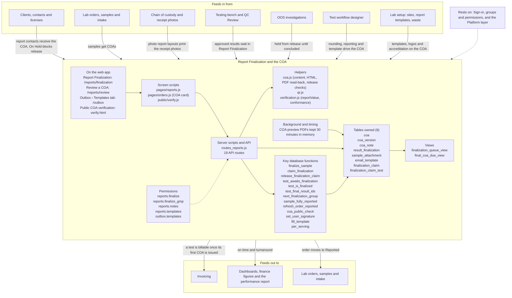

### Connections

| Direction | Module | What flows |
|---|---|---|
| In, from | Clients, contacts and licenses | report contacts receive the COA; On Hold blocks release |
| In, from | Lab orders, samples and intake | samples get COAs |
| In, from | Chain of custody and receipt photos | photo report layouts print the receipt photos |
| In, from | Testing bench and QC Review | approved results wait in Report Finalization |
| In, from | OOS investigations | held from release until concluded |
| In, from | Test workflow designer | rounding, reporting and template drive the COA |
| In, from | Lab setup: sites, report templates, waste | templates, logos and accreditation on the COA |
| Out, to | Invoicing | a test is billable once its first COA is issued |
| Out, to | Dashboards, finance figures and the performance report | on time and turnaround |
| Out, to | Lab orders, samples and intake | order moves to Reported |
| Rests on | Sign-in, groups and permissions; Platform | session, lab and permission checks; audit trail; search; paging |

### Components

| Layer | Components |
|---|---|
| Pages on the web app | Report Finalization (`#/reports/finalization`); Review a COA (`#/reports/review`); Outbox › Templates tab (`#/outbox`); Public COA verification (`verify.html`) |
| Screen scripts | pages/reports.js; pages/orders.js (COA card); public/verify.js |
| Server scripts | routes_reports.js |
| Helpers | coa.js (content, HTML, PDF read-back, release checks); qr.js; verification.js (reportValue, conformance) |
| Background and timing | COA preview PDFs kept 30 minutes in memory |
| Migrations | `026_result_finalization_coa`, `028_report_finalization_followup`, `030_report_templates_lab_media` |
| Tables owned (8) | `coa` (026_result_finalization_coa), `coa_version` (026_result_finalization_coa), `coa_note` (026_result_finalization_coa), `result_finalization` (026_result_finalization_coa), `sample_attachment` (026_result_finalization_coa), `email_template` (026_result_finalization_coa), `finalization_claim` (028_report_finalization_followup), `finalization_claim_test` (028_report_finalization_followup) |
| Key database functions | `finalize_sample` (026_result_finalization_coa; replaced in 027_oos_investigations), `claim_finalization` (028_report_finalization_followup), `release_finalization_claim` (028_report_finalization_followup), `test_awaits_finalization` (026_result_finalization_coa), `test_is_finalized` (026_result_finalization_coa), `test_final_result_ids` (026_result_finalization_coa), `next_finalization_group` (026_result_finalization_coa), `sample_fully_reported` (026_result_finalization_coa; replaced in 027_oos_investigations), `refresh_order_reported` (026_result_finalization_coa), `coa_public_check` (026_result_finalization_coa), `set_user_signature` (028_report_finalization_followup), `fill_template` (026_result_finalization_coa), `per_serving` (028_report_finalization_followup) |
| Views | `finalization_queue_view` (026_result_finalization_coa), `final_coa_due_view` (028_report_finalization_followup) |
| Permissions | `reports.finalize`, `reports.finalize_gmp`, `reports.notes`, `reports.templates`, `outbox.templates` |
| Tests | `test_021a_report_followup`, `test_022_result_finalization`, `test_025_report_templates`, `e2e_reports`, `e2e_labsetup`, `coa_parts` |

### API routes (19)

| Method | Path | Defined at |
|---|---|---|
| GET | `/api/reports/queue` | `routes_reports.js:26` |
| POST | `/api/reports/claim` | `routes_reports.js:46` |
| POST | `/api/reports/claims/:id/release` | `routes_reports.js:55` |
| GET | `/api/reports/issued` | `routes_reports.js:69` |
| GET | `/api/orders/:id/coas` | `routes_reports.js:79` |
| POST | `/api/reports/preview` | `routes_reports.js:119` |
| GET | `/api/reports/preview/:token` | `routes_reports.js:133` |
| POST | `/api/reports/notes` | `routes_reports.js:140` |
| POST | `/api/reports/notes/:id/remove` | `routes_reports.js:148` |
| POST | `/api/reports/finalize` | `routes_reports.js:156` |
| GET | `/api/reports/samples/:id/coa` | `routes_reports.js:189` |
| GET | `/api/reports/coa/:id/pdf` | `routes_reports.js:199` |
| GET | `/api/public/coa/:code` | `routes_reports.js:210` |
| POST | `/api/samples/:id/attachments` | `routes_reports.js:217` |
| GET | `/api/attachments/:id/file` | `routes_reports.js:230` |
| GET | `/api/outbox/templates` | `routes_reports.js:241` |
| POST | `/api/outbox/templates` | `routes_reports.js:242` |
| GET | `/api/compliance-categories` | `routes_reports.js:243` |
| POST | `/api/compliance-categories` | `routes_reports.js:244` |

## 9. OOS investigations

**Section:** Testing. Opened by a person from QC Review (never automatically): automatic checks, analyst and supervisor sections, QA conclusion, Phase II, retests, the client's answer through a token link, and billing by QA determination.

**How it works:**
1. Flagged in QC Review; Open OOS…
2. Automatic data checks (9 checks)
3. Analyst, then supervisor sections (signed)
4. QA concludes: OOS confirmed or assignable cause (signed, report PDF)
5. Released result emails the client with answer links (public OOS page)
6. Retest ordered; billing set by determination; Phase II decision

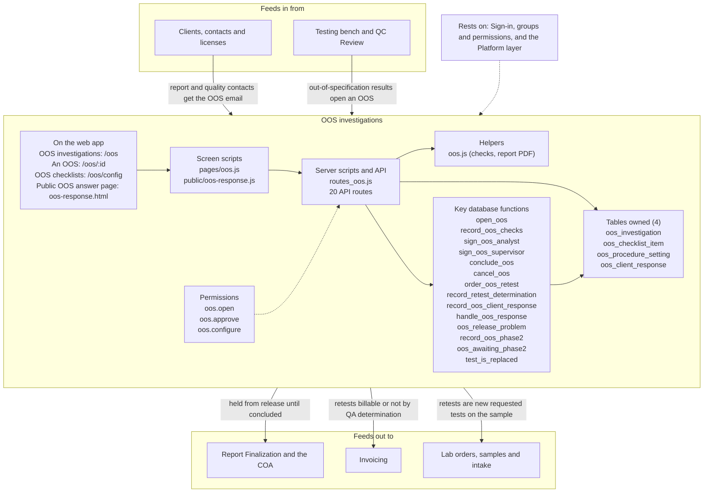

### Connections

| Direction | Module | What flows |
|---|---|---|
| In, from | Clients, contacts and licenses | report and quality contacts get the OOS email |
| In, from | Testing bench and QC Review | out-of-specification results open an OOS |
| Out, to | Report Finalization and the COA | held from release until concluded |
| Out, to | Invoicing | retests billable or not by QA determination |
| Out, to | Lab orders, samples and intake | retests are new requested tests on the sample |
| Rests on | Sign-in, groups and permissions; Platform | session, lab and permission checks; audit trail; search; paging |

### Components

| Layer | Components |
|---|---|
| Pages on the web app | OOS investigations (`#/oos`); An OOS (`#/oos/:id`); OOS checklists (`#/oos/config`); Public OOS answer page (`oos-response.html`) |
| Screen scripts | pages/oos.js; public/oos-response.js |
| Server scripts | routes_oos.js |
| Helpers | oos.js (checks, report PDF) |
| Migrations | `027_oos_investigations`, `028_report_finalization_followup` |
| Tables owned (4) | `oos_investigation` (027_oos_investigations), `oos_checklist_item` (027_oos_investigations), `oos_procedure_setting` (027_oos_investigations), `oos_client_response` (027_oos_investigations) |
| Key database functions | `open_oos` (027_oos_investigations), `record_oos_checks` (027_oos_investigations), `sign_oos_analyst` (027_oos_investigations), `sign_oos_supervisor` (027_oos_investigations), `conclude_oos` (027_oos_investigations), `cancel_oos` (027_oos_investigations), `order_oos_retest` (027_oos_investigations), `record_retest_determination` (027_oos_investigations), `record_oos_client_response` (027_oos_investigations), `handle_oos_response` (027_oos_investigations), `oos_release_problem` (027_oos_investigations), `record_oos_phase2` (028_report_finalization_followup), `oos_awaiting_phase2` (028_report_finalization_followup), `test_is_replaced` (027_oos_investigations) |
| Permissions | `oos.open`, `oos.approve`, `oos.configure` |
| Tests | `test_023_oos`, `e2e_oos` |

### API routes (20)

| Method | Path | Defined at |
|---|---|---|
| GET | `/api/oos` | `routes_oos.js:33` |
| GET | `/api/oos/for` | `routes_oos.js:44` |
| POST | `/api/oos/:id/phase2` | `routes_oos.js:57` |
| GET | `/api/oos/config` | `routes_oos.js:62` |
| GET | `/api/oos/:id` | `routes_oos.js:66` |
| POST | `/api/oos/open` | `routes_oos.js:85` |
| POST | `/api/oos/:id/checks` | `routes_oos.js:94` |
| POST | `/api/oos/:id/analyst` | `routes_oos.js:95` |
| POST | `/api/oos/:id/supervisor` | `routes_oos.js:100` |
| POST | `/api/oos/:id/conclude` | `routes_oos.js:106` |
| POST | `/api/oos/:id/cancel` | `routes_oos.js:119` |
| POST | `/api/oos/:id/retest` | `routes_oos.js:123` |
| POST | `/api/oos/:id/determination` | `routes_oos.js:128` |
| POST | `/api/oos/responses/:rid/handled` | `routes_oos.js:133` |
| GET | `/api/oos/:id/report.pdf` | `routes_oos.js:139` |
| GET | `/api/outbox/:id/document` | `routes_oos.js:148` |
| GET | `/api/public/oos/:token` | `routes_oos.js:159` |
| POST | `/api/public/oos/:token` | `routes_oos.js:168` |
| POST | `/api/oos/config/items` | `routes_oos.js:176` |
| POST | `/api/oos/config/settings` | `routes_oos.js:177` |

## 10. Stability studies

**Section:** Testing. Quoted as a whole (conditions × timepoints × tests), accepted into a study, placed in chamber racks, pulled on schedule into lab orders, amended, cancelled, excursions assessed, and reported cumulatively (signed).

**How it works:**
1. Stability quote: conditions, timepoints, tests matrix (Pricing › Stability quotes)
2. Client accepts: study created with its T0 order
3. Place material in chamber racks (study page › Place)
4. Hourly job orders pulls on their dates (makeDuePulls)
5. Pulls tested like any order
6. Excursions assessed by QA; amendments and cancellation
7. Cumulative report issued (signed)

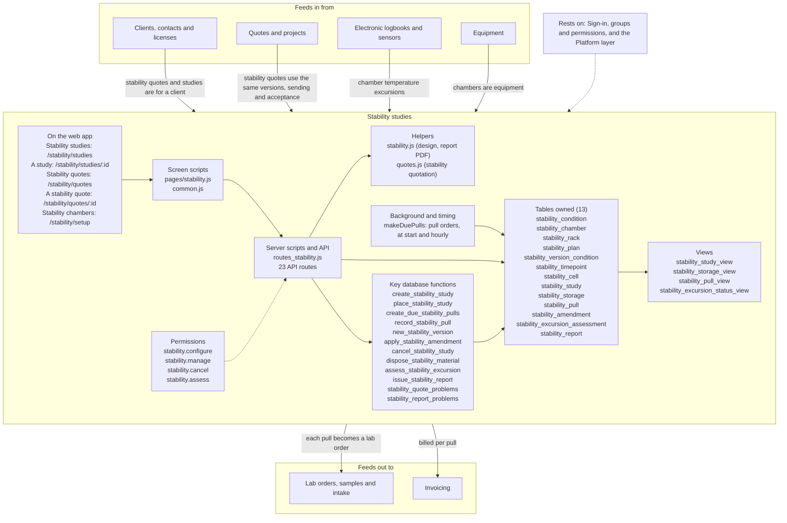

### Connections

| Direction | Module | What flows |
|---|---|---|
| In, from | Clients, contacts and licenses | stability quotes and studies are for a client |
| In, from | Quotes and projects | stability quotes use the same versions, sending and acceptance |
| In, from | Electronic logbooks and sensors | chamber temperature excursions |
| In, from | Equipment | chambers are equipment |
| Out, to | Lab orders, samples and intake | each pull becomes a lab order |
| Out, to | Invoicing | billed per pull |
| Rests on | Sign-in, groups and permissions; Platform | session, lab and permission checks; audit trail; search; paging |

### Components

| Layer | Components |
|---|---|
| Pages on the web app | Stability studies (`#/stability/studies`); A study (`#/stability/studies/:id`); Stability quotes (`#/stability/quotes`); A stability quote (`#/stability/quotes/:id`); Stability chambers (`#/stability/setup`) |
| Screen scripts | pages/stability.js; common.js |
| Server scripts | routes_stability.js |
| Helpers | stability.js (design, report PDF); quotes.js (stability quotation) |
| Background and timing | makeDuePulls: pull orders, at start and hourly |
| Migrations | `032_stability_studies`, `041_stability_s2` |
| Tables owned (13) | `stability_condition` (032_stability_studies), `stability_chamber` (032_stability_studies), `stability_rack` (032_stability_studies), `stability_plan` (032_stability_studies), `stability_version_condition` (032_stability_studies), `stability_timepoint` (032_stability_studies), `stability_cell` (032_stability_studies), `stability_study` (032_stability_studies), `stability_storage` (032_stability_studies), `stability_pull` (032_stability_studies), `stability_amendment` (041_stability_s2), `stability_excursion_assessment` (041_stability_s2), `stability_report` (041_stability_s2) |
| Key database functions | `create_stability_study` (032_stability_studies), `place_stability_study` (032_stability_studies; replaced in 041_stability_s2), `create_due_stability_pulls` (032_stability_studies), `record_stability_pull` (032_stability_studies; replaced in 041_stability_s2), `new_stability_version` (032_stability_studies; replaced in 041_stability_s2), `apply_stability_amendment` (041_stability_s2), `cancel_stability_study` (041_stability_s2), `dispose_stability_material` (041_stability_s2), `assess_stability_excursion` (041_stability_s2), `issue_stability_report` (041_stability_s2), `stability_quote_problems` (032_stability_studies; replaced in 041_stability_s2), `stability_report_problems` (041_stability_s2) |
| Views | `stability_study_view` (032_stability_studies), `stability_storage_view` (032_stability_studies), `stability_pull_view` (032_stability_studies), `stability_excursion_status_view` (041_stability_s2) |
| Permissions | `stability.configure`, `stability.manage`, `stability.cancel`, `stability.assess` |
| Tests | `test_027_stability`, `test_036_stability_s2`, `e2e_stability`, `e2e_stability_s2` |

### API routes (23)

| Method | Path | Defined at |
|---|---|---|
| GET | `/api/stability/setup` | `routes_stability.js:17` |
| POST | `/api/stability/conditions` | `routes_stability.js:42` |
| POST | `/api/stability/chambers` | `routes_stability.js:48` |
| POST | `/api/stability/racks` | `routes_stability.js:52` |
| GET | `/api/stability/quotes` | `routes_stability.js:58` |
| POST | `/api/stability/quotes` | `routes_stability.js:65` |
| GET | `/api/stability/quotes/:id` | `routes_stability.js:111` |
| POST | `/api/stability/versions/:vid/design` | `routes_stability.js:114` |
| POST | `/api/stability/quotes/:id/new-version` | `routes_stability.js:193` |
| GET | `/api/stability/studies` | `routes_stability.js:198` |
| GET | `/api/stability/studies/:id` | `routes_stability.js:209` |
| POST | `/api/stability/studies/:id/place` | `routes_stability.js:244` |
| POST | `/api/stability/pulls/:id/record` | `routes_stability.js:252` |
| POST | `/api/stability/pulls/create-due` | `routes_stability.js:260` |
| GET | `/api/stability/studies/:id/report` | `routes_stability.js:264` |
| GET | `/api/stability/studies/:id/report.pdf` | `routes_stability.js:270` |
| POST | `/api/stability/studies/:id/cancel` | `routes_stability.js:287` |
| POST | `/api/stability/storage/:id/dispose` | `routes_stability.js:294` |
| POST | `/api/stability/studies/:id/excursions/:entry/assess` | `routes_stability.js:303` |
| GET | `/api/stability/studies/:id/report-preview.pdf` | `routes_stability.js:327` |
| POST | `/api/stability/studies/:id/reports` | `routes_stability.js:335` |
| GET | `/api/stability/reports-due` | `routes_stability.js:351` |
| GET | `/api/stability/reports/:id/pdf` | `routes_stability.js:361` |

## 11. Electronic logbooks and sensors

**Section:** Testing. Designed logbooks for equipment checks, temperatures, inocula, controls and sample weights; entries can make lots and feed results; iMonnit sensors write hourly, excursion and no-data entries.

**How it works:**
1. Design the logbook; QA approves the version (Logbook › Design tab)
2. Record entries by paste (signed); failures need a reason
3. Sensor feed writes hourly and excursion entries (sensor_feed.js, every minute)
4. QA reviews entries daily or weekly (Admin › QA › Logbook review)
5. Approved values feed results; failures flag QC Review

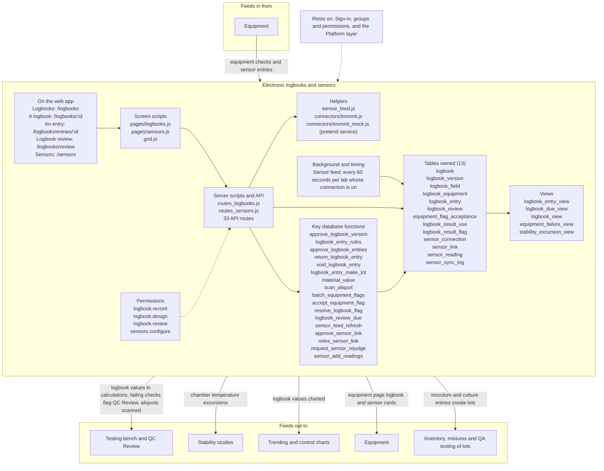

### Connections

| Direction | Module | What flows |
|---|---|---|
| In, from | Equipment | equipment checks and sensor entries |
| Out, to | Testing bench and QC Review | logbook values in calculations; failing checks flag QC Review; aliquots scanned |
| Out, to | Stability studies | chamber temperature excursions |
| Out, to | Trending and control charts | logbook values charted |
| Out, to | Equipment | equipment page logbook and sensor cards |
| Out, to | Inventory, mixtures and QA testing of lots | inoculum and culture entries create lots |
| Rests on | Sign-in, groups and permissions; Platform | session, lab and permission checks; audit trail; search; paging |

### Components

| Layer | Components |
|---|---|
| Pages on the web app | Logbooks (`#/logbooks`); A logbook (`#/logbooks/:id`); An entry (`#/logbooks/entries/:id`); Logbook review (`#/logbooks/review`); Sensors (`#/sensors`) |
| Screen scripts | pages/logbooks.js; pages/sensors.js; grid.js |
| Server scripts | routes_logbooks.js; routes_sensors.js |
| Helpers | sensor_feed.js; connectors/imonnit.js; connectors/imonnit_mock.js (pretend service) |
| Background and timing | Sensor feed: every 60 seconds per lab whose connection is on |
| Migrations | `034_logbooks`, `035_logbook_values_feed_results`, `045_sensor_feed`, `046_sensor_rejudge` |
| Tables owned (13) | `logbook` (034_logbooks), `logbook_version` (034_logbooks), `logbook_field` (034_logbooks), `logbook_equipment` (034_logbooks), `logbook_entry` (034_logbooks), `logbook_review` (034_logbooks), `equipment_flag_acceptance` (034_logbooks), `logbook_result_use` (035_logbook_values_feed_results), `logbook_result_flag` (035_logbook_values_feed_results), `sensor_connection` (045_sensor_feed), `sensor_link` (045_sensor_feed), `sensor_reading` (045_sensor_feed), `sensor_sync_log` (045_sensor_feed) |
| Key database functions | `approve_logbook_version` (034_logbooks), `logbook_entry_rules` (034_logbooks), `approve_logbook_entries` (034_logbooks), `return_logbook_entry` (034_logbooks), `void_logbook_entry` (034_logbooks), `logbook_entry_make_lot` (034_logbooks), `material_value` (035_logbook_values_feed_results), `scan_aliquot` (035_logbook_values_feed_results), `batch_equipment_flags` (034_logbooks), `accept_equipment_flag` (034_logbooks), `resolve_logbook_flag` (035_logbook_values_feed_results), `logbook_review_due` (034_logbooks), `sensor_feed_refresh` (045_sensor_feed; replaced in 046_sensor_rejudge, 046_sensor_rejudge), `approve_sensor_link` (045_sensor_feed), `retire_sensor_link` (045_sensor_feed), `request_sensor_rejudge` (046_sensor_rejudge), `sensor_add_readings` (045_sensor_feed) |
| Views | `logbook_entry_view` (034_logbooks), `logbook_due_view` (034_logbooks), `logbook_view` (034_logbooks), `equipment_failure_view` (034_logbooks), `stability_excursion_view` (034_logbooks) |
| Permissions | `logbook.record`, `logbook.design`, `logbook.review`, `sensors.configure` |
| Tests | `test_029_logbooks`, `test_030_logbook_values`, `test_039_sensor_feed`, `test_040_sensor_rejudge`, `e2e_logbooks`, `e2e_sensors`, `imonnit_feed_test` |

### API routes (33)

| Method | Path | Defined at |
|---|---|---|
| GET | `/api/logbooks` | `routes_logbooks.js:65` |
| POST | `/api/logbooks` | `routes_logbooks.js:82` |
| GET | `/api/logbooks/review` | `routes_logbooks.js:94` |
| POST | `/api/logbooks/review/approve` | `routes_logbooks.js:103` |
| GET | `/api/logbooks/excursions` | `routes_logbooks.js:113` |
| GET | `/api/logbooks/:id` | `routes_logbooks.js:123` |
| POST | `/api/logbooks/:id/settings` | `routes_logbooks.js:157` |
| POST | `/api/logbooks/:id/new-version` | `routes_logbooks.js:167` |
| POST | `/api/logbooks/:id/fields` | `routes_logbooks.js:172` |
| POST | `/api/logbooks/:id/approve` | `routes_logbooks.js:199` |
| POST | `/api/logbooks/:id/equipment` | `routes_logbooks.js:206` |
| POST | `/api/logbooks/:id/entries` | `routes_logbooks.js:261` |
| GET | `/api/logbooks/entries/:id` | `routes_logbooks.js:278` |
| POST | `/api/logbooks/entries/:id/correct` | `routes_logbooks.js:302` |
| POST | `/api/logbooks/entries/:id/return` | `routes_logbooks.js:317` |
| POST | `/api/logbooks/entries/:id/void` | `routes_logbooks.js:321` |
| GET | `/api/testing/batches/:id/equipment-flags` | `routes_logbooks.js:331` |
| POST | `/api/testing/batches/:id/accept-flag` | `routes_logbooks.js:339` |
| GET | `/api/testing/batches/:id/lot-entries` | `routes_logbooks.js:359` |
| POST | `/api/testing/step-runs/:id/scan-aliquot` | `routes_logbooks.js:364` |
| GET | `/api/testing/batches/:id/aliquots` | `routes_logbooks.js:373` |
| POST | `/api/logbooks/flags/:id/resolve` | `routes_logbooks.js:378` |
| GET | `/api/logbooks/for-equipment/:id` | `routes_logbooks.js:387` |
| GET | `/api/logbooks/for-lot/:id` | `routes_logbooks.js:407` |
| GET | `/api/sensors` | `routes_sensors.js:19` |
| POST | `/api/sensors/connection` | `routes_sensors.js:56` |
| POST | `/api/sensors/links` | `routes_sensors.js:69` |
| POST | `/api/sensors/links/:id/approve` | `routes_sensors.js:77` |
| POST | `/api/sensors/links/:id/retire` | `routes_sensors.js:84` |
| POST | `/api/sensors/links/:id/rejudge` | `routes_sensors.js:92` |
| POST | `/api/sensors/read-now` | `routes_sensors.js:104` |
| POST | `/api/logbooks/entries/:id/reason` | `routes_sensors.js:113` |
| GET | `/api/sensors/equipment/:id` | `routes_sensors.js:127` |

## 12. Trending and control charts

**Section:** Testing. Control charts of results, QC, logbooks, stability and counts with Western Electric rules, Cp/Cpk, frozen limits approved by QA, report packs to PDF and Excel, and limits pushed into a test version.

**How it works:**
1. Build a chart from any source (Trending › Build a chart)
2. Save; freeze limits (chart page)
3. QA approves the chart (signed)
4. Signals reviewed with a comment (Trend watch)
5. Approved QC charts shown in QC Review › Trends
6. Use the limits in a new test version (chart page › Use these limits)

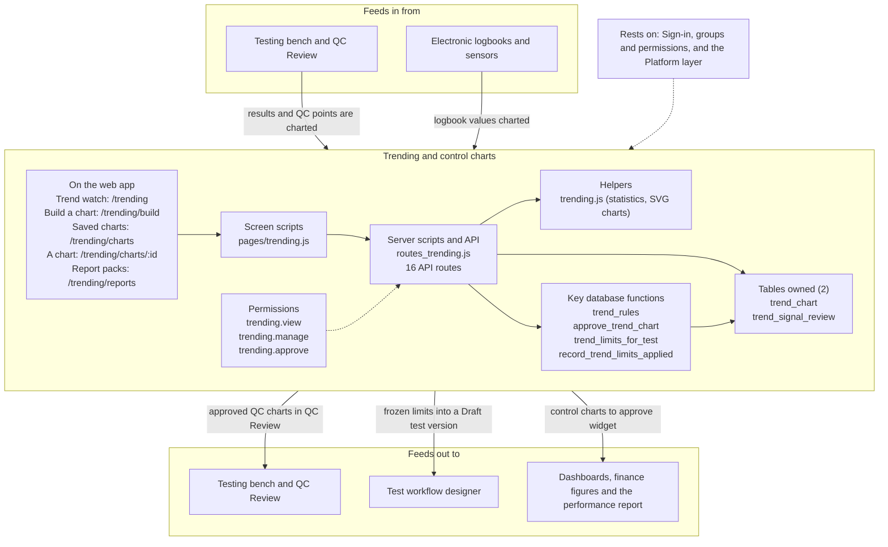

### Connections

| Direction | Module | What flows |
|---|---|---|
| In, from | Testing bench and QC Review | results and QC points are charted |
| In, from | Electronic logbooks and sensors | logbook values charted |
| Out, to | Testing bench and QC Review | approved QC charts in QC Review |
| Out, to | Test workflow designer | frozen limits into a Draft test version |
| Out, to | Dashboards, finance figures and the performance report | control charts to approve widget |
| Rests on | Sign-in, groups and permissions; Platform | session, lab and permission checks; audit trail; search; paging |

### Components

| Layer | Components |
|---|---|
| Pages on the web app | Trend watch (`#/trending`); Build a chart (`#/trending/build`); Saved charts (`#/trending/charts`); A chart (`#/trending/charts/:id`); Report packs (`#/trending/reports`) |
| Screen scripts | pages/trending.js |
| Server scripts | routes_trending.js |
| Helpers | trending.js (statistics, SVG charts) |
| Migrations | `043_trending`, `044_trending_qa` |
| Tables owned (2) | `trend_chart` (043_trending), `trend_signal_review` (043_trending) |
| Key database functions | `trend_rules` (043_trending), `approve_trend_chart` (044_trending_qa), `trend_limits_for_test` (044_trending_qa), `record_trend_limits_applied` (044_trending_qa) |
| Permissions | `trending.view`, `trending.manage`, `trending.approve` |
| Tests | `test_037_trending`, `test_038_trending_qa`, `e2e_trending` |

### API routes (16)

| Method | Path | Defined at |
|---|---|---|
| GET | `/api/trending/options` | `routes_trending.js:36` |
| POST | `/api/trending/build` | `routes_trending.js:104` |
| GET | `/api/trending/charts` | `routes_trending.js:122` |
| GET | `/api/trending/charts/:id` | `routes_trending.js:128` |
| POST | `/api/trending/charts/:id/approve` | `routes_trending.js:139` |
| POST | `/api/trending/charts/:id/apply-limits` | `routes_trending.js:147` |
| POST | `/api/trending/charts` | `routes_trending.js:184` |
| POST | `/api/trending/charts/:id/freeze` | `routes_trending.js:199` |
| POST | `/api/trending/charts/:id/unfreeze` | `routes_trending.js:211` |
| POST | `/api/trending/charts/:id/retire` | `routes_trending.js:215` |
| POST | `/api/trending/signals/review` | `routes_trending.js:220` |
| GET | `/api/trending/watch` | `routes_trending.js:231` |
| GET | `/api/trending/packs/:pack` | `routes_trending.js:251` |
| GET | `/api/trending/review/:batchId` | `routes_trending.js:275` |
| POST | `/api/trending/export.xlsx` | `routes_trending.js:294` |
| POST | `/api/trending/pdf` | `routes_trending.js:303` |

## 13. Training and competency

**Section:** Testing. Qualifications per person and test, initial and continuing competency by training samples or records, rules per department, legacy qualifications, a training report, and an optional gate at the bench.

**How it works:**
1. Rules per department: trained after N tests (Training › Rules)
2. Start competency: training samples or a record (person page)
3. Trainer evaluates (signed Evaluated by)
4. QA approves (signed): qualification granted
5. The gate checks qualification when a bench step is signed (when the lab turns it on)

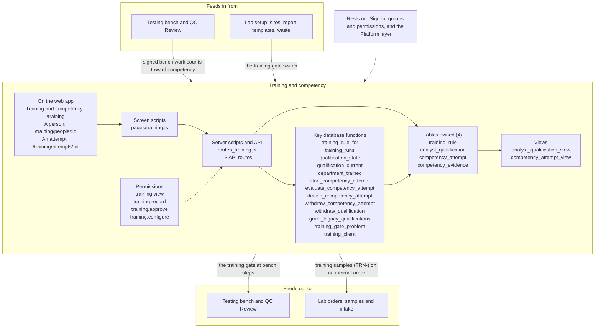

### Connections

| Direction | Module | What flows |
|---|---|---|
| In, from | Testing bench and QC Review | signed bench work counts toward competency |
| In, from | Lab setup: sites, report templates, waste | the training gate switch |
| Out, to | Testing bench and QC Review | the training gate at bench steps |
| Out, to | Lab orders, samples and intake | training samples (TRN-) on an internal order |
| Rests on | Sign-in, groups and permissions; Platform | session, lab and permission checks; audit trail; search; paging |

### Components

| Layer | Components |
|---|---|
| Pages on the web app | Training and competency (`#/training`); A person (`#/training/people/:id`); An attempt (`#/training/attempts/:id`) |
| Screen scripts | pages/training.js |
| Server scripts | routes_training.js |
| Migrations | `053_training_competency`, `055_dept_training_metrc_licenses` |
| Tables owned (4) | `training_rule` (053_training_competency), `analyst_qualification` (053_training_competency), `competency_attempt` (053_training_competency), `competency_evidence` (053_training_competency) |
| Key database functions | `training_rule_for` (053_training_competency), `training_runs` (053_training_competency), `qualification_state` (053_training_competency), `qualification_current` (053_training_competency), `department_trained` (053_training_competency), `start_competency_attempt` (053_training_competency), `evaluate_competency_attempt` (053_training_competency), `decide_competency_attempt` (053_training_competency), `withdraw_competency_attempt` (053_training_competency), `withdraw_qualification` (053_training_competency), `grant_legacy_qualifications` (053_training_competency), `training_gate_problem` (053_training_competency), `training_client` (053_training_competency) |
| Views | `analyst_qualification_view` (053_training_competency), `competency_attempt_view` (053_training_competency) |
| Permissions | `training.view`, `training.record`, `training.approve`, `training.configure` |
| Tests | `test_046_training`, `test_048_dept_training_metrc_licenses`, `e2e_training` |

### API routes (13)

| Method | Path | Defined at |
|---|---|---|
| GET | `/api/training` | `routes_training.js:23` |
| GET | `/api/training/people/:id` | `routes_training.js:62` |
| GET | `/api/training/people/:id/report.pdf` | `routes_training.js:74` |
| POST | `/api/training/attempts` | `routes_training.js:107` |
| GET | `/api/training/attempts/:id` | `routes_training.js:114` |
| POST | `/api/training/attempts/:id/evidence` | `routes_training.js:123` |
| GET | `/api/training/evidence/:id/file` | `routes_training.js:140` |
| POST | `/api/training/attempts/:id/evaluate` | `routes_training.js:149` |
| POST | `/api/training/attempts/:id/decide` | `routes_training.js:154` |
| POST | `/api/training/attempts/:id/withdraw` | `routes_training.js:160` |
| POST | `/api/training/qualifications/:id/withdraw` | `routes_training.js:165` |
| POST | `/api/training/legacy` | `routes_training.js:174` |
| POST | `/api/training/rules` | `routes_training.js:180` |

## 14. Test workflow designer

**Section:** Tests and workflows. Each test's versioned design: analytes and reporting (rounding, LOQ/LOD, uncertainty, per serving), specifications, QC criteria per analyte, the workflow steps (11 types) with equipment types and connections, methods (SOPs), signed changes and approval by someone who did not build it.

**How it works:**
1. Tab 1 Test and reporting: rounding, LOQ/LOD, report template
2. Tab 2 Analytes and limits
3. Tab 3 Workflow steps, equipment types, QC criteria (diagram)
4. Tab 4 Review: problems list
5. Workflow verification when the lab requires it
6. Approved by someone else (signed Approved by)

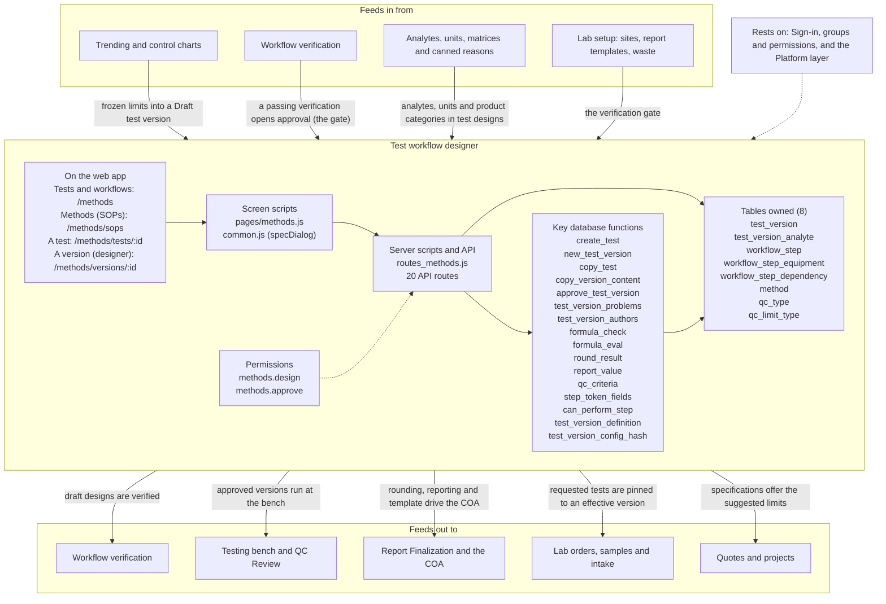

### Connections

| Direction | Module | What flows |
|---|---|---|
| In, from | Trending and control charts | frozen limits into a Draft test version |
| In, from | Workflow verification | a passing verification opens approval (the gate) |
| In, from | Analytes, units, matrices and canned reasons | analytes, units and product categories in test designs |
| In, from | Lab setup: sites, report templates, waste | the verification gate |
| Out, to | Workflow verification | draft designs are verified |
| Out, to | Testing bench and QC Review | approved versions run at the bench |
| Out, to | Report Finalization and the COA | rounding, reporting and template drive the COA |
| Out, to | Lab orders, samples and intake | requested tests are pinned to an effective version |
| Out, to | Quotes and projects | specifications offer the suggested limits |
| Rests on | Sign-in, groups and permissions; Platform | session, lab and permission checks; audit trail; search; paging |

### Components

| Layer | Components |
|---|---|
| Pages on the web app | Tests and workflows (`#/methods`); Methods (SOPs) (`#/methods/sops`); A test (`#/methods/tests/:id`); A version (designer) (`#/methods/versions/:id`) |
| Screen scripts | pages/methods.js; common.js (specDialog) |
| Server scripts | routes_methods.js |
| Migrations | `012_workflow_designer`, `013_workflow_designer_micro`, `014_qc_criteria_per_analyte`, `015_methods_signatures`, `021_runs_preliminary_results`, `033_serving_measurement`, `039_matrix_bench_alerts_invalid_readings` |
| Tables owned (8) | `test_version` (002_catalog_pricing_projects), `test_version_analyte` (012_workflow_designer), `workflow_step` (012_workflow_designer), `workflow_step_equipment` (012_workflow_designer), `workflow_step_dependency` (012_workflow_designer), `method` (012_workflow_designer), `qc_type` (012_workflow_designer), `qc_limit_type` (012_workflow_designer) |
| Key database functions | `create_test` (012_workflow_designer), `new_test_version` (012_workflow_designer), `copy_test` (012_workflow_designer), `copy_version_content` (012_workflow_designer; replaced in 013_workflow_designer_micro, 014_qc_criteria_per_analyte), `approve_test_version` (012_workflow_designer; replaced in 024_workflow_verification), `test_version_problems` (012_workflow_designer; replaced in 013_workflow_designer_micro, 014_qc_criteria_per_analyte, 039_matrix_bench_alerts_invalid_readings), `test_version_authors` (012_workflow_designer), `formula_check` (012_workflow_designer), `formula_eval` (012_workflow_designer), `round_result` (012_workflow_designer), `report_value` (012_workflow_designer), `qc_criteria` (014_qc_criteria_per_analyte), `step_token_fields` (012_workflow_designer; replaced in 035_logbook_values_feed_results), `can_perform_step` (012_workflow_designer), `test_version_definition` (024_workflow_verification; replaced in 039_matrix_bench_alerts_invalid_readings), `test_version_config_hash` (024_workflow_verification) |
| Permissions | `methods.design`, `methods.approve` |
| Tests | `test_011_methods`, `test_012_micro_definitions`, `test_013_qc_criteria`, `test_014_methods_signatures`, `test_034_matrix_bench_alerts`, `e2e_methods`, `e2e_bax` |

### API routes (20)

| Method | Path | Defined at |
|---|---|---|
| GET | `/api/methods/me` | `routes_methods.js:60` |
| GET | `/api/methods/new-options` | `routes_methods.js:61` |
| GET | `/api/methods/tests` | `routes_methods.js:68` |
| POST | `/api/methods/tests` | `routes_methods.js:74` |
| GET | `/api/methods/tests/:id` | `routes_methods.js:83` |
| POST | `/api/methods/tests/:id/new-version` | `routes_methods.js:93` |
| POST | `/api/methods/tests/:id/copy` | `routes_methods.js:97` |
| GET | `/api/methods/versions/:id` | `routes_methods.js:108` |
| GET | `/api/methods/versions/:id/problems` | `routes_methods.js:147` |
| PUT | `/api/methods/versions/:id/header` | `routes_methods.js:152` |
| POST | `/api/methods/versions/:id/analytes` | `routes_methods.js:162` |
| POST | `/api/methods/versions/:id/steps` | `routes_methods.js:169` |
| POST | `/api/methods/versions/:id/steps/:stepId/remove` | `routes_methods.js:221` |
| POST | `/api/methods/versions/:id/steps/order` | `routes_methods.js:225` |
| POST | `/api/methods/versions/:id/approve` | `routes_methods.js:233` |
| POST | `/api/methods/formula-test` | `routes_methods.js:239` |
| GET | `/api/methods/sops` | `routes_methods.js:250` |
| POST | `/api/methods/sops` | `routes_methods.js:256` |
| GET | `/api/specs` | `routes_methods.js:282` |
| POST | `/api/specs` | `routes_methods.js:290` |

## 15. Workflow verification

**Section:** Tests and workflows. An automatic run of a draft test through its whole workflow by automated accounts, with an independent calculation, screenshots as evidence and a Word report; QA approves the protocol and signs the report.

**How it works:**
1. Write the protocol from the design: URS, FRS, samples, expected results (designer › Review tab)
2. QA approves the protocol
3. Execute: automated accounts run the workflow in one transaction
4. Screenshots captured as evidence (background, Playwright)
5. QA signs the report: Pass, Pass with exceptions or Fail
6. The gate lets the version be approved

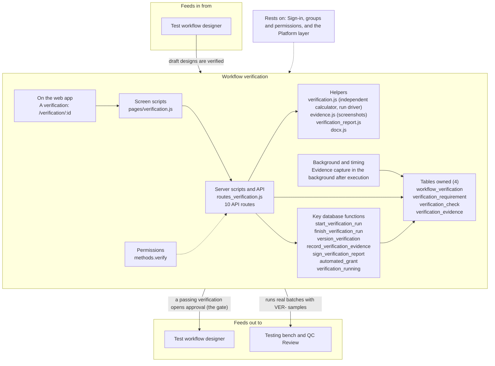

### Connections

| Direction | Module | What flows |
|---|---|---|
| In, from | Test workflow designer | draft designs are verified |
| Out, to | Test workflow designer | a passing verification opens approval (the gate) |
| Out, to | Testing bench and QC Review | runs real batches with VER- samples |
| Rests on | Sign-in, groups and permissions; Platform | session, lab and permission checks; audit trail; search; paging |

### Components

| Layer | Components |
|---|---|
| Pages on the web app | A verification (`#/verification/:id`) |
| Screen scripts | pages/verification.js |
| Server scripts | routes_verification.js |
| Helpers | verification.js (independent calculator, run driver); evidence.js (screenshots); verification_report.js; docx.js |
| Background and timing | Evidence capture in the background after execution |
| Migrations | `024_workflow_verification`, `025_verification_evidence` |
| Tables owned (4) | `workflow_verification` (024_workflow_verification), `verification_requirement` (024_workflow_verification), `verification_check` (024_workflow_verification), `verification_evidence` (025_verification_evidence) |
| Key database functions | `start_verification_run` (024_workflow_verification), `finish_verification_run` (024_workflow_verification), `version_verification` (024_workflow_verification), `record_verification_evidence` (025_verification_evidence), `sign_verification_report` (024_workflow_verification; replaced in 025_verification_evidence), `automated_grant` (024_workflow_verification), `verification_running` (024_workflow_verification) |
| Permissions | `methods.verify` |
| Tests | `test_021_verification`, `e2e_verification` |

### API routes (10)

| Method | Path | Defined at |
|---|---|---|
| GET | `/api/verification/versions/:id` | `routes_verification.js:33` |
| POST | `/api/verification/versions/:id/protocol` | `routes_verification.js:45` |
| GET | `/api/verification/:id` | `routes_verification.js:73` |
| POST | `/api/verification/:id/approve-protocol` | `routes_verification.js:76` |
| POST | `/api/verification/:id/execute` | `routes_verification.js:83` |
| POST | `/api/verification/:id/capture-evidence` | `routes_verification.js:120` |
| GET | `/api/verification/:id/evidence/:seq` | `routes_verification.js:132` |
| GET | `/api/verification/:id/report.docx` | `routes_verification.js:143` |
| POST | `/api/verification/:id/sign-report` | `routes_verification.js:155` |
| POST | `/api/verification/:id/cancel` | `routes_verification.js:163` |

## 16. Inventory, mixtures and QA testing of lots

**Section:** Lab supplies. Every lot of every material (INV-): requests, receipt, usage, adjustments, transfers, in-house mixtures with calculated concentrations, supplier COAs (optional AI reading), storage locations, sample storage, warning rules, QA testing before use, and disposal by waste classification.

**How it works:**
1. New item or receive many (signed)
2. Supplier COA uploaded and read
3. QA testing before use when the lab requires it
4. Released lots used at the bench (stock drawn)
5. Mixtures from component lots
6. Low, expiring and negative stock flagged
7. Dispose by waste classification

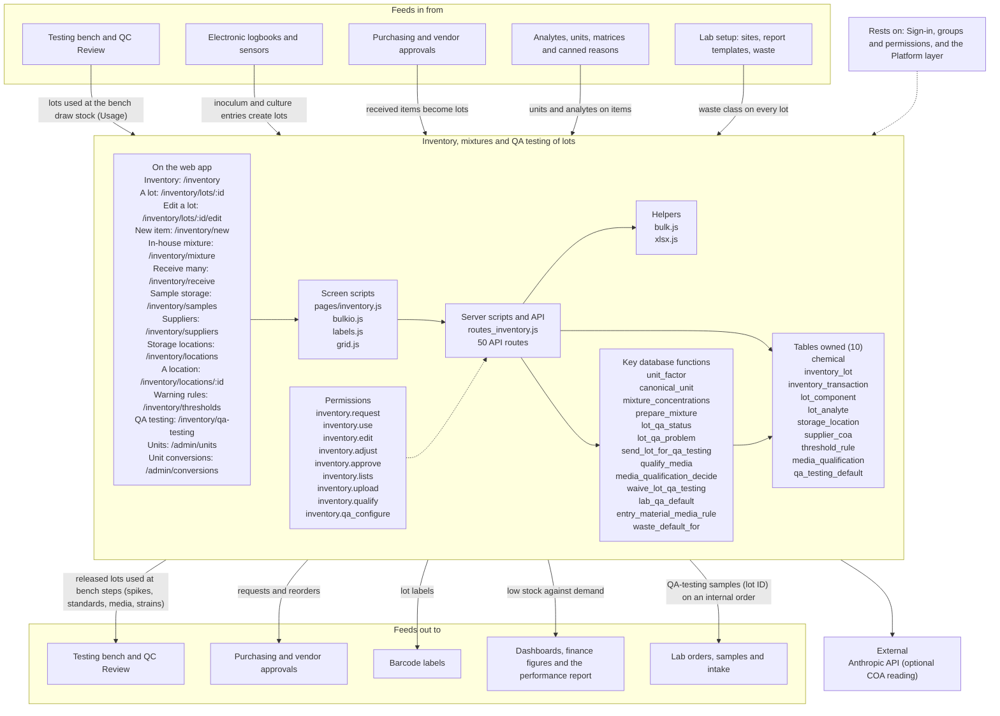

### Connections

| Direction | Module | What flows |
|---|---|---|
| In, from | Testing bench and QC Review | lots used at the bench draw stock (Usage) |
| In, from | Electronic logbooks and sensors | inoculum and culture entries create lots |
| In, from | Purchasing and vendor approvals | received items become lots |
| In, from | Analytes, units, matrices and canned reasons | units and analytes on items |
| In, from | Lab setup: sites, report templates, waste | waste class on every lot |
| Out, to | Testing bench and QC Review | released lots used at bench steps (spikes, standards, media, strains) |
| Out, to | Purchasing and vendor approvals | requests and reorders |
| Out, to | Barcode labels | lot labels |
| Out, to | Dashboards, finance figures and the performance report | low stock against demand |
| Out, to | Lab orders, samples and intake | QA-testing samples (lot ID) on an internal order |
| Rests on | Sign-in, groups and permissions; Platform | session, lab and permission checks; audit trail; search; paging |

### Components

| Layer | Components |
|---|---|
| Pages on the web app | Inventory (`#/inventory`); A lot (`#/inventory/lots/:id`); Edit a lot (`#/inventory/lots/:id/edit`); New item (`#/inventory/new`); In-house mixture (`#/inventory/mixture`); Receive many (`#/inventory/receive`); Sample storage (`#/inventory/samples`); Suppliers (`#/inventory/suppliers`); Storage locations (`#/inventory/locations`); A location (`#/inventory/locations/:id`); Warning rules (`#/inventory/thresholds`); QA testing (`#/inventory/qa-testing`); Units (`#/admin/units`); Unit conversions (`#/admin/conversions`) |
| Screen scripts | pages/inventory.js; bulkio.js; labels.js; grid.js |
| Server scripts | routes_inventory.js |
| Helpers | bulk.js; xlsx.js |
| External systems | Anthropic API (optional COA reading) |
| Migrations | `005_inventory`, `006_inventory_items_units`, `017_bench_stock_usage`, `023_media_purchasing_batch_edits`, `037_dashboards`, `040_lot_qa_testing`, `052_waste_classifications` |
| Tables owned (10) | `chemical` (005_inventory), `inventory_lot` (005_inventory), `inventory_transaction` (005_inventory), `lot_component` (005_inventory), `lot_analyte` (006_inventory_items_units), `storage_location` (005_inventory), `supplier_coa` (005_inventory), `threshold_rule` (005_inventory), `media_qualification` (023_media_purchasing_batch_edits), `qa_testing_default` (040_lot_qa_testing) |
| Key database functions | `unit_factor` (006_inventory_items_units), `canonical_unit` (006_inventory_items_units), `mixture_concentrations` (006_inventory_items_units; replaced in 007_login_signatures_reasons), `prepare_mixture` (006_inventory_items_units; replaced in 007_login_signatures_reasons), `lot_qa_status` (040_lot_qa_testing), `lot_qa_problem` (040_lot_qa_testing), `send_lot_for_qa_testing` (040_lot_qa_testing), `qualify_media` (023_media_purchasing_batch_edits; replaced in 040_lot_qa_testing), `media_qualification_decide` (023_media_purchasing_batch_edits; replaced in 040_lot_qa_testing), `waive_lot_qa_testing` (040_lot_qa_testing), `lab_qa_default` (040_lot_qa_testing), `entry_material_media_rule` (023_media_purchasing_batch_edits; replaced in 040_lot_qa_testing), `waste_default_for` (052_waste_classifications) |
| Permissions | `inventory.request`, `inventory.use`, `inventory.edit`, `inventory.adjust`, `inventory.approve`, `inventory.lists`, `inventory.upload`, `inventory.qualify`, `inventory.qa_configure` |
| Tests | `test_005_inventory`, `test_006_items_units`, `test_020_media_batches_purchasing`, `test_035_lot_qa_testing`, `test_045_waste`, `e2e_inventory`, `e2e_media_labels`, `e2e_qa_testing`, `e2e_waste` |

### API routes (50)

| Method | Path | Defined at |
|---|---|---|
| GET | `/api/inventory/me` | `routes_inventory.js:105` |
| GET | `/api/inventory/meta` | `routes_inventory.js:112` |
| GET | `/api/units` | `routes_inventory.js:126` |
| POST | `/api/units/bulk` | `routes_inventory.js:128` |
| GET | `/api/unit-conversions` | `routes_inventory.js:129` |
| POST | `/api/unit-conversions/bulk` | `routes_inventory.js:131` |
| GET | `/api/units/convertible` | `routes_inventory.js:133` |
| GET | `/api/units/convert` | `routes_inventory.js:134` |
| GET | `/api/inventory/chemicals` | `routes_inventory.js:137` |
| POST | `/api/inventory/chemicals/bulk` | `routes_inventory.js:139` |
| GET | `/api/inventory/suppliers` | `routes_inventory.js:140` |
| POST | `/api/inventory/suppliers/bulk` | `routes_inventory.js:142` |
| GET | `/api/inventory/locations` | `routes_inventory.js:143` |
| POST | `/api/inventory/locations/bulk` | `routes_inventory.js:147` |
| GET | `/api/inventory/locations/:id` | `routes_inventory.js:150` |
| GET | `/api/inventory/thresholds` | `routes_inventory.js:162` |
| POST | `/api/inventory/thresholds/bulk` | `routes_inventory.js:164` |
| GET | `/api/inventory/sites` | `routes_inventory.js:165` |
| GET | `/api/inventory/lots` | `routes_inventory.js:173` |
| GET | `/api/inventory/dashboard` | `routes_inventory.js:186` |
| GET | `/api/inventory/lots/:id` | `routes_inventory.js:194` |
| POST | `/api/inventory/lots/bulk` | `routes_inventory.js:230` |
| POST | `/api/inventory/items` | `routes_inventory.js:252` |
| POST | `/api/inventory/coa/read` | `routes_inventory.js:274` |
| GET | `/api/inventory/lots/:id/qualify-options` | `routes_inventory.js:285` |
| POST | `/api/inventory/lots/:id/qualify` | `routes_inventory.js:292` |
| POST | `/api/inventory/lots/:id/waive-qa` | `routes_inventory.js:303` |
| GET | `/api/inventory/qa-defaults` | `routes_inventory.js:312` |
| POST | `/api/inventory/qa-defaults` | `routes_inventory.js:322` |
| PUT | `/api/inventory/items/:id` | `routes_inventory.js:337` |
| PUT | `/api/inventory/lots/:id` | `routes_inventory.js:344` |
| POST | `/api/inventory/requests` | `routes_inventory.js:346` |
| POST | `/api/inventory/lots/:id/purchase-status` | `routes_inventory.js:350` |
| POST | `/api/inventory/lots/:id/cancel` | `routes_inventory.js:360` |
| POST | `/api/inventory/lots/:id/reorder` | `routes_inventory.js:364` |
| POST | `/api/inventory/lots/:id/receive` | `routes_inventory.js:368` |
| POST | `/api/inventory/lots/:id/transfer` | `routes_inventory.js:374` |
| POST | `/api/inventory/lots/:id/dispose` | `routes_inventory.js:378` |
| POST | `/api/inventory/movements` | `routes_inventory.js:381` |
| POST | `/api/inventory/mixtures` | `routes_inventory.js:401` |
| POST | `/api/inventory/mixtures/preview` | `routes_inventory.js:409` |
| POST | `/api/inventory/mixtures/prepare` | `routes_inventory.js:418` |
| POST | `/api/bulk/:kind/export` | `routes_inventory.js:428` |
| POST | `/api/bulk/:kind/preview` | `routes_inventory.js:444` |
| POST | `/api/bulk/:kind/apply` | `routes_inventory.js:451` |
| POST | `/api/inventory/lots/:id/coa` | `routes_inventory.js:478` |
| GET | `/api/inventory/coa/:id/file` | `routes_inventory.js:496` |
| POST | `/api/inventory/coa/:id/confirm` | `routes_inventory.js:506` |
| GET | `/api/inventory/samples` | `routes_inventory.js:519` |
| POST | `/api/inventory/samples/bulk` | `routes_inventory.js:521` |

## 17. Purchasing and vendor approvals

**Section:** Lab supplies. One approval queue for everything bought, second approval above the lab's amount, orders grouped by supplier with the finance PO, receiving per line with problems, packing slips and actual price, risk classes and supply scopes, and vendor approvals by lab QA or Corporate QA.

**How it works:**
1. Request (anyone)
2. Approve; second approval above the lab's amount
3. Order: lines grouped by supplier, finance PO typed
4. Receive per line: partial, problems, slips, actual price
5. Items go into inventory or the equipment register
6. Vendors approved by QA (lab) or Corporate QA (all labs); only approved vendors can be ordered from

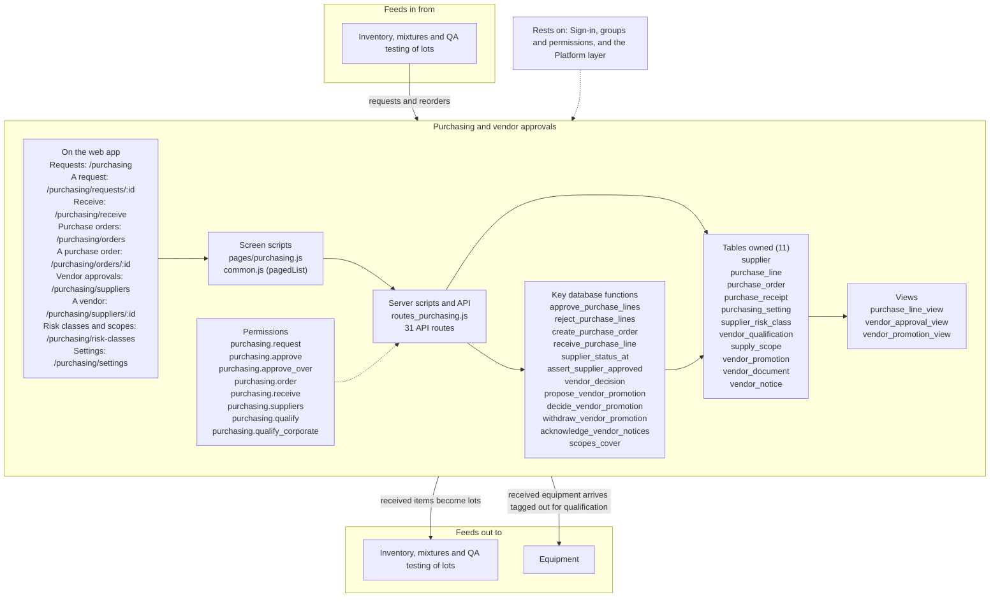

### Connections

| Direction | Module | What flows |
|---|---|---|
| In, from | Inventory, mixtures and QA testing of lots | requests and reorders |
| Out, to | Inventory, mixtures and QA testing of lots | received items become lots |
| Out, to | Equipment | received equipment arrives tagged out for qualification |
| Rests on | Sign-in, groups and permissions; Platform | session, lab and permission checks; audit trail; search; paging |

### Components

| Layer | Components |
|---|---|
| Pages on the web app | Requests (`#/purchasing`); A request (`#/purchasing/requests/:id`); Receive (`#/purchasing/receive`); Purchase orders (`#/purchasing/orders`); A purchase order (`#/purchasing/orders/:id`); Vendor approvals (`#/purchasing/suppliers`); A vendor (`#/purchasing/suppliers/:id`); Risk classes and scopes (`#/purchasing/risk-classes`); Settings (`#/purchasing/settings`) |
| Screen scripts | pages/purchasing.js; common.js (pagedList) |
| Server scripts | routes_purchasing.js |
| Migrations | `011_purchasing`, `023_media_purchasing_batch_edits`, `050_vendor_approvals` |
| Tables owned (11) | `supplier` (005_inventory), `purchase_line` (011_purchasing), `purchase_order` (011_purchasing), `purchase_receipt` (011_purchasing), `purchasing_setting` (011_purchasing), `supplier_risk_class` (011_purchasing), `vendor_qualification` (011_purchasing), `supply_scope` (050_vendor_approvals), `vendor_promotion` (050_vendor_approvals), `vendor_document` (050_vendor_approvals), `vendor_notice` (050_vendor_approvals) |
| Key database functions | `approve_purchase_lines` (011_purchasing), `reject_purchase_lines` (011_purchasing), `create_purchase_order` (011_purchasing), `receive_purchase_line` (011_purchasing; replaced in 023_media_purchasing_batch_edits), `supplier_status_at` (011_purchasing; replaced in 050_vendor_approvals), `assert_supplier_approved` (011_purchasing), `vendor_decision` (050_vendor_approvals), `propose_vendor_promotion` (050_vendor_approvals), `decide_vendor_promotion` (050_vendor_approvals), `withdraw_vendor_promotion` (050_vendor_approvals), `acknowledge_vendor_notices` (050_vendor_approvals), `scopes_cover` (050_vendor_approvals) |
| Views | `purchase_line_view` (011_purchasing), `vendor_approval_view` (050_vendor_approvals), `vendor_promotion_view` (050_vendor_approvals) |
| Permissions | `purchasing.request`, `purchasing.approve`, `purchasing.approve_over`, `purchasing.order`, `purchasing.receive`, `purchasing.suppliers`, `purchasing.qualify`, `purchasing.qualify_corporate` |
| Tests | `test_010_purchasing`, `test_020_media_batches_purchasing`, `test_043_vendor_approvals`, `e2e_purchasing`, `e2e_vendors` |

### API routes (31)

| Method | Path | Defined at |
|---|---|---|
| GET | `/api/purchasing/me` | `routes_purchasing.js:47` |
| GET | `/api/purchasing/lines` | `routes_purchasing.js:57` |
| GET | `/api/purchasing/lines/:id` | `routes_purchasing.js:75` |
| POST | `/api/purchasing/lines` | `routes_purchasing.js:85` |
| PUT | `/api/purchasing/lines/:id` | `routes_purchasing.js:94` |
| POST | `/api/purchasing/approve` | `routes_purchasing.js:100` |
| POST | `/api/purchasing/reject` | `routes_purchasing.js:106` |
| POST | `/api/purchasing/orders` | `routes_purchasing.js:114` |
| GET | `/api/purchasing/orders` | `routes_purchasing.js:123` |
| GET | `/api/purchasing/orders/:id` | `routes_purchasing.js:136` |
| PUT | `/api/purchasing/orders/:id` | `routes_purchasing.js:145` |
| POST | `/api/purchasing/lines/:id/receive` | `routes_purchasing.js:153` |
| GET | `/api/purchasing/receipts/:id/slip` | `routes_purchasing.js:171` |
| GET | `/api/purchasing/suppliers` | `routes_purchasing.js:181` |
| GET | `/api/purchasing/suppliers/:id` | `routes_purchasing.js:188` |
| POST | `/api/purchasing/suppliers/:id/qualifications` | `routes_purchasing.js:226` |
| POST | `/api/purchasing/qualifications/:id/withdraw` | `routes_purchasing.js:244` |
| POST | `/api/purchasing/qualifications/:id/documents` | `routes_purchasing.js:251` |
| POST | `/api/purchasing/documents/:id/withdraw` | `routes_purchasing.js:259` |
| GET | `/api/purchasing/documents/:id/file` | `routes_purchasing.js:267` |
| POST | `/api/purchasing/qualifications/:id/propose` | `routes_purchasing.js:280` |
| POST | `/api/purchasing/promotions/:id/decide` | `routes_purchasing.js:292` |
| POST | `/api/purchasing/promotions/:id/withdraw` | `routes_purchasing.js:303` |
| POST | `/api/purchasing/notices/acknowledge` | `routes_purchasing.js:310` |
| GET | `/api/purchasing/vendors` | `routes_purchasing.js:317` |
| GET | `/api/purchasing/scopes` | `routes_purchasing.js:329` |
| POST | `/api/purchasing/scopes` | `routes_purchasing.js:334` |
| GET | `/api/purchasing/risk-classes` | `routes_purchasing.js:344` |
| POST | `/api/purchasing/risk-classes` | `routes_purchasing.js:349` |
| GET | `/api/purchasing/settings` | `routes_purchasing.js:361` |
| PUT | `/api/purchasing/settings` | `routes_purchasing.js:362` |

## 18. Equipment

**Section:** Lab supplies. One register for every instrument: types, departments, owners, calibration and maintenance with certificates, qualifications, tag-outs with independent release, automatic tag-out when calibration expires or maintenance is due, transfers between labs.

**How it works:**
1. Add equipment (or Add many by paste)
2. Calibration with certificate
3. Hourly job tags out expired calibration and overdue maintenance
4. Repair or calibration: released by someone else
5. Due and overdue list

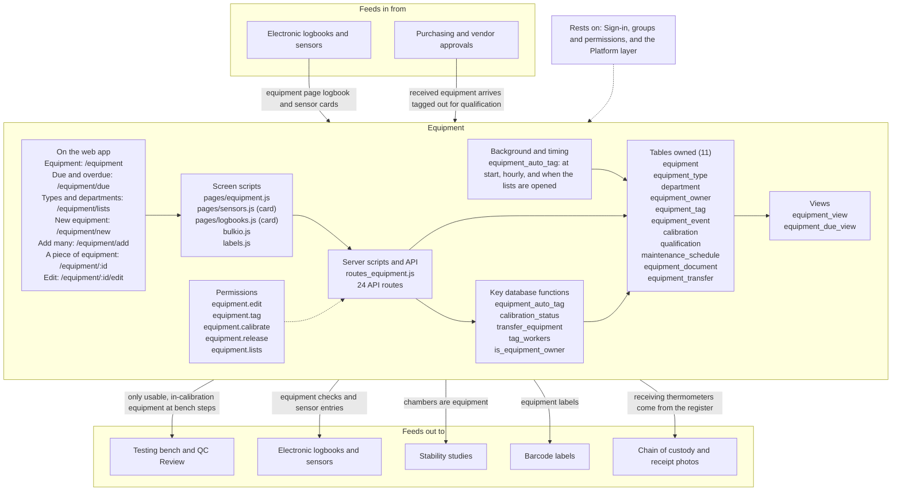

### Connections

| Direction | Module | What flows |
|---|---|---|
| In, from | Electronic logbooks and sensors | equipment page logbook and sensor cards |
| In, from | Purchasing and vendor approvals | received equipment arrives tagged out for qualification |
| Out, to | Testing bench and QC Review | only usable, in-calibration equipment at bench steps |
| Out, to | Electronic logbooks and sensors | equipment checks and sensor entries |
| Out, to | Stability studies | chambers are equipment |
| Out, to | Barcode labels | equipment labels |
| Out, to | Chain of custody and receipt photos | receiving thermometers come from the register |
| Rests on | Sign-in, groups and permissions; Platform | session, lab and permission checks; audit trail; search; paging |

### Components

| Layer | Components |
|---|---|
| Pages on the web app | Equipment (`#/equipment`); Due and overdue (`#/equipment/due`); Types and departments (`#/equipment/lists`); New equipment (`#/equipment/new`); Add many (`#/equipment/add`); A piece of equipment (`#/equipment/:id`); Edit (`#/equipment/:id/edit`) |
| Screen scripts | pages/equipment.js; pages/sensors.js (card); pages/logbooks.js (card); bulkio.js; labels.js |
| Server scripts | routes_equipment.js |
| Background and timing | equipment_auto_tag: at start, hourly, and when the lists are opened |
| Migrations | `009_equipment`, `010_equipment_department` |
| Tables owned (11) | `equipment` (009_equipment), `equipment_type` (009_equipment), `department` (009_equipment), `equipment_owner` (009_equipment), `equipment_tag` (009_equipment), `equipment_event` (009_equipment), `calibration` (009_equipment), `qualification` (009_equipment), `maintenance_schedule` (009_equipment), `equipment_document` (009_equipment), `equipment_transfer` (009_equipment) |
| Key database functions | `equipment_auto_tag` (009_equipment), `calibration_status` (009_equipment), `transfer_equipment` (009_equipment; replaced in 010_equipment_department), `tag_workers` (009_equipment), `is_equipment_owner` (009_equipment) |
| Views | `equipment_view` (009_equipment), `equipment_due_view` (009_equipment) |
| Permissions | `equipment.edit`, `equipment.tag`, `equipment.calibrate`, `equipment.release`, `equipment.lists` |
| Tests | `test_009_equipment`, `e2e_equipment` |

### API routes (24)

| Method | Path | Defined at |
|---|---|---|
| GET | `/api/equipment/me` | `routes_equipment.js:46` |
| GET | `/api/equipment/lists` | `routes_equipment.js:54` |
| POST | `/api/equipment/types/bulk` | `routes_equipment.js:67` |
| POST | `/api/equipment/departments/bulk` | `routes_equipment.js:71` |
| GET | `/api/equipment` | `routes_equipment.js:77` |
| GET | `/api/equipment/due` | `routes_equipment.js:90` |
| GET | `/api/equipment/transfer-options` | `routes_equipment.js:97` |
| GET | `/api/equipment/:id` | `routes_equipment.js:107` |
| POST | `/api/equipment` | `routes_equipment.js:163` |
| POST | `/api/equipment/many` | `routes_equipment.js:173` |
| PUT | `/api/equipment/:id` | `routes_equipment.js:190` |
| POST | `/api/equipment/:id/status` | `routes_equipment.js:198` |
| POST | `/api/equipment/:id/tag-out` | `routes_equipment.js:206` |
| POST | `/api/equipment/:id/events` | `routes_equipment.js:221` |
| POST | `/api/equipment/tags/:tagId/tag-in` | `routes_equipment.js:227` |
| POST | `/api/equipment/:id/calibrations` | `routes_equipment.js:246` |
| PUT | `/api/equipment/calibrations/:cid` | `routes_equipment.js:258` |
| POST | `/api/equipment/:id/qualifications` | `routes_equipment.js:265` |
| PUT | `/api/equipment/qualifications/:qid` | `routes_equipment.js:276` |
| POST | `/api/equipment/:id/documents` | `routes_equipment.js:283` |
| POST | `/api/equipment/documents/bulk` | `routes_equipment.js:288` |
| GET | `/api/equipment/documents/:docId/file` | `routes_equipment.js:294` |
| POST | `/api/equipment/:id/schedules` | `routes_equipment.js:305` |
| POST | `/api/equipment/:id/transfer` | `routes_equipment.js:313` |

## 19. Barcode labels

**Section:** Lab supplies. Printable Code 128 labels for samples (2 1/8 × 4 in., tests and due dates), lots, equipment and batches (1 × 2 1/8 in.), sized for the Dymo LabelWriter; scanned IDs open records.

**How it works:**
1. Print labels from the record (order, lot, equipment or batch page)
2. Copies default to units or containers (label dialog)
3. Scanned IDs open records in any search box

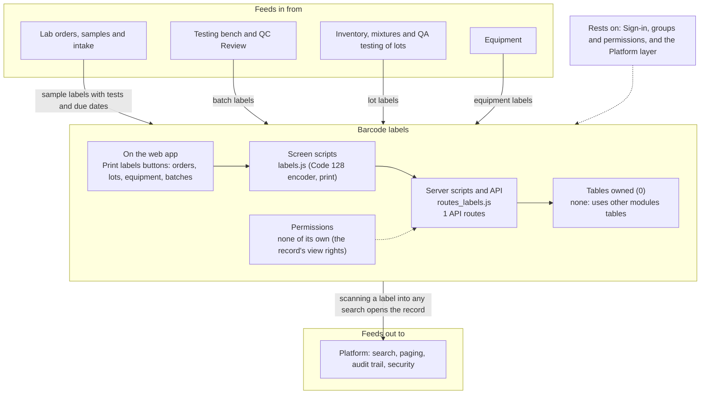

### Connections

| Direction | Module | What flows |
|---|---|---|
| In, from | Lab orders, samples and intake | sample labels with tests and due dates |
| In, from | Testing bench and QC Review | batch labels |
| In, from | Inventory, mixtures and QA testing of lots | lot labels |
| In, from | Equipment | equipment labels |
| Out, to | Platform: search, paging, audit trail, security | scanning a label into any search opens the record |
| Rests on | Sign-in, groups and permissions; Platform | session, lab and permission checks; audit trail; search; paging |

### Components

| Layer | Components |
|---|---|
| Pages on the web app | Print labels buttons (`orders, lots, equipment, batches`) |
| Screen scripts | labels.js (Code 128 encoder, print) |
| Server scripts | routes_labels.js |
| Migrations | `023_media_purchasing_batch_edits` |
| Tables owned (0) | none: it reads the records of the module it prints |
| Permissions | `none of its own (the record's view rights)` |
| Tests | `e2e_media_labels` |

### API routes (1)

| Method | Path | Defined at |
|---|---|---|
| GET | `/api/labels/:kind` | `routes_labels.js:10` |

## 20. Invoicing

**Section:** Billing. Completed work (COA issued) and charges claimed into draft invoices per order, prices and late rush checked, issued with gapless numbers, emailed, queued for QuickBooks; credit notes, never edits; payments recorded; PO number corrections with a corrected copy; catch-up invoicing.

**How it works:**
1. Completed tests and charges appear in Ready to invoice
2. Claim into a draft per order
3. Check price and late rush (reason); add charges
4. Issue (signed Invoiced by): number, PDF, email
5. Queued for QuickBooks (accounting_push)
6. Record payment; correct the PO (signed, corrected copy); credit note when wrong

```mermaid
flowchart TB
  subgraph IN["Feeds in from"]
    direction LR
    in0["Clients, contacts and licenses"]
    in1["Lab orders, samples and intake"]
    in2["Test catalogue, pricing and packages"]
    in3["Report Finalization and the COA"]
    in4["OOS investigations"]
    in5["Stability studies"]
    in6["Charges, service lines and the test picker"]
  end
  subgraph MOD["Invoicing"]
    direction LR
    UI["On the web app<br/>Ready to invoice: /billing<br/>My draft invoices: /billing?tab=mine<br/>Invoices: /billing?tab=issued<br/>An invoice: /billing/invoices/:id<br/>Order › Billing card: /orders/:id"]
    SC["Screen scripts<br/>pages/billing.js<br/>pages/orders.js (Billing card)<br/>common.js (pagedList)"]
    SV["Server scripts and API<br/>routes_invoicing.js<br/>20 API routes"]
    HL["Helpers<br/>invoices.js (PDF)"]
    DBT["Tables owned (7)<br/>invoice<br/>invoice_line<br/>invoice_counter<br/>invoice_correction<br/>accounting_connection<br/>accounting_customer<br/>accounting_push"]
    DBF["Key database functions<br/>claim_invoice_work<br/>issue_invoices<br/>credit_invoice<br/>set_invoice_line_price<br/>set_invoice_line_rush<br/>send_invoice<br/>qbo_payload<br/>invoice_catch_up<br/>next_invoice_number<br/>record_invoice_payment<br/>invoice_payment_status<br/>correct_invoice_po<br/>billing_completed_at<br/>test_reported_at"]
    DBV["Views<br/>billable_test_view<br/>invoice_ready_view<br/>invoice_view"]
    PM["Permissions<br/>invoicing.view<br/>invoicing.issue"]
    UI --> SC --> SV
    SV --> HL
    SV --> DBT
    SV --> DBF --> DBT
    DBT --> DBV
    PM -.-> SV
  end
  subgraph OUTG["Feeds out to"]
    direction LR
    out0["Dashboards, finance figures and the performance report"]
  end
  in0 -->|"billing contacts and payment terms"| MOD
  in1 -->|"completed tests and order charges are billed"| MOD
  in2 -->|"list price on invoice lines"| MOD
  in3 -->|"a test is billable once its first COA is issued"| MOD
  in4 -->|"retests billable or not by QA determination"| MOD
  in5 -->|"billed per pull"| MOD
  in6 -->|"order charges become invoice lines"| MOD
  MOD -->|"revenue, billing and the performance report"| out0
  EXT["External<br/>QuickBooks Online (queued, no sender yet)<br/>Email (Outbox, not sent in the Sandbox)"]
  MOD --> EXT
  FD["Rests on: Sign-in, groups and permissions, and the Platform layer"]
  FD -.-> MOD
```

### Connections

| Direction | Module | What flows |
|---|---|---|
| In, from | Clients, contacts and licenses | billing contacts and payment terms |
| In, from | Lab orders, samples and intake | completed tests and order charges are billed |
| In, from | Test catalogue, pricing and packages | list price on invoice lines |
| In, from | Report Finalization and the COA | a test is billable once its first COA is issued |
| In, from | OOS investigations | retests billable or not by QA determination |
| In, from | Stability studies | billed per pull |
| In, from | Charges, service lines and the test picker | order charges become invoice lines |
| Out, to | Dashboards, finance figures and the performance report | revenue, billing and the performance report |
| Rests on | Sign-in, groups and permissions; Platform | session, lab and permission checks; audit trail; search; paging |

### Components

| Layer | Components |
|---|---|
| Pages on the web app | Ready to invoice (`#/billing`); My draft invoices (`#/billing?tab=mine`); Invoices (`#/billing?tab=issued`); An invoice (`#/billing/invoices/:id`); Order › Billing card (`#/orders/:id`) |
| Screen scripts | pages/billing.js; pages/orders.js (Billing card); common.js (pagedList) |
| Server scripts | routes_invoicing.js |
| Helpers | invoices.js (PDF) |
| External systems | QuickBooks Online (queued, no sender yet); Email (Outbox, not sent in the Sandbox) |
| Migrations | `036_invoicing`, `058_charges_service_lines_catalogue_orders` |
| Tables owned (7) | `invoice` (036_invoicing), `invoice_line` (036_invoicing), `invoice_counter` (036_invoicing), `invoice_correction` (058_charges_service_lines_catalogue_orders), `accounting_connection` (036_invoicing), `accounting_customer` (036_invoicing), `accounting_push` (036_invoicing) |
| Key database functions | `claim_invoice_work` (036_invoicing), `issue_invoices` (036_invoicing; replaced in 058_charges_service_lines_catalogue_orders), `credit_invoice` (036_invoicing; replaced in 058_charges_service_lines_catalogue_orders), `set_invoice_line_price` (036_invoicing), `set_invoice_line_rush` (036_invoicing), `send_invoice` (036_invoicing), `qbo_payload` (036_invoicing; replaced in 058_charges_service_lines_catalogue_orders), `invoice_catch_up` (036_invoicing), `next_invoice_number` (036_invoicing), `record_invoice_payment` (058_charges_service_lines_catalogue_orders), `invoice_payment_status` (058_charges_service_lines_catalogue_orders), `correct_invoice_po` (058_charges_service_lines_catalogue_orders), `billing_completed_at` (036_invoicing), `test_reported_at` (036_invoicing) |
| Views | `billable_test_view` (036_invoicing), `invoice_ready_view` (036_invoicing), `invoice_view` (036_invoicing) |
| Permissions | `invoicing.view`, `invoicing.issue` |
| Tests | `test_031_invoicing`, `test_051_charges_catalogue_orders`, `e2e_invoicing`, `e2e_charges_ordering` |

### API routes (20)

| Method | Path | Defined at |
|---|---|---|
| GET | `/api/billing/ready` | `routes_invoicing.js:39` |
| GET | `/api/billing/invoices` | `routes_invoicing.js:54` |
| POST | `/api/billing/claim` | `routes_invoicing.js:79` |
| GET | `/api/billing/invoices/:id` | `routes_invoicing.js:93` |
| PUT | `/api/billing/invoices/:id` | `routes_invoicing.js:120` |
| POST | `/api/billing/lines/:id/price` | `routes_invoicing.js:124` |
| POST | `/api/billing/lines/:id/rush` | `routes_invoicing.js:133` |
| POST | `/api/billing/lines/remove` | `routes_invoicing.js:140` |
| POST | `/api/billing/invoices/:id/release` | `routes_invoicing.js:149` |
| POST | `/api/billing/issue` | `routes_invoicing.js:206` |
| POST | `/api/billing/invoices/:id/credit` | `routes_invoicing.js:220` |
| GET | `/api/billing/invoices/:id/pdf` | `routes_invoicing.js:232` |
| GET | `/api/orders/:id/billing` | `routes_invoicing.js:244` |
| GET | `/api/billing/settings` | `routes_invoicing.js:257` |
| POST | `/api/billing/settings/terms` | `routes_invoicing.js:268` |
| PUT | `/api/billing/settings/connection` | `routes_invoicing.js:278` |
| POST | `/api/billing/invoices/:id/charges` | `routes_invoicing.js:155` |
| POST | `/api/billing/invoices/:id/payment` | `routes_invoicing.js:171` |
| POST | `/api/billing/invoices/:id/correct-po` | `routes_invoicing.js:180` |
| GET | `/api/billing/corrections/:id/pdf` | `routes_invoicing.js:195` |

## 21. Analytes, units, matrices and canned reasons

**Section:** Master data. The controlled lists the rest of the system relies on: analytes with CAS and molar mass, units and conversions, matrices and product categories, compliance categories, canned reasons.

**How it works:**
1. QA or an administrator keeps the list by paste and fill down
2. Reason for change on every save
3. The database refuses bad values (CAS check digit, unknown unit)
4. Lists feed pick lists everywhere (smart dropdowns)

```mermaid
flowchart TB
  subgraph MOD["Analytes, units, matrices and canned reasons"]
    direction LR
    UI["On the web app<br/>Analytes: /analytes<br/>Units: /admin/units<br/>Unit conversions: /admin/conversions<br/>Matrices (and product and compliance categories): /admin/matrices<br/>Canned reasons: /admin/reasons"]
    SC["Screen scripts<br/>pages/master.js<br/>pages/admin.js<br/>pages/inventory.js (units)<br/>grid.js<br/>bulkio.js"]
    SV["Server scripts and API<br/>routes.js (its part)<br/>9 API routes"]
    HL["Helpers<br/>bulk.js"]
    DBT["Tables owned (7)<br/>analyte<br/>unit_of_measure<br/>unit_conversion<br/>matrix<br/>product_category<br/>compliance_category<br/>reason_code"]
    DBF["Key database functions<br/>is_valid_cas<br/>require_list_permission<br/>sample_is_gmp"]
    PM["Permissions<br/>master.analytes<br/>master.units<br/>master.matrices<br/>master.compliance<br/>master.reasons<br/>master.molar_mass"]
    UI --> SC --> SV
    SV --> HL
    SV --> DBT
    SV --> DBF --> DBT
    PM -.-> SV
  end
  subgraph OUTG["Feeds out to"]
    direction LR
    out0["Test workflow designer"]
    out1["Lab orders, samples and intake"]
    out2["Inventory, mixtures and QA testing of lots"]
    out3["Platform: search, paging, audit trail, security"]
  end
  MOD -->|"analytes, units and product categories in test designs"| out0
  MOD -->|"matrix and compliance category on samples"| out1
  MOD -->|"units and analytes on items"| out2
  MOD -->|"canned reasons in every reason dialog"| out3
  FD["Rests on: Sign-in, groups and permissions, and the Platform layer"]
  FD -.-> MOD
```

### Connections

| Direction | Module | What flows |
|---|---|---|
| Out, to | Test workflow designer | analytes, units and product categories in test designs |
| Out, to | Lab orders, samples and intake | matrix and compliance category on samples |
| Out, to | Inventory, mixtures and QA testing of lots | units and analytes on items |
| Out, to | Platform: search, paging, audit trail, security | canned reasons in every reason dialog |
| Rests on | Sign-in, groups and permissions; Platform | session, lab and permission checks; audit trail; search; paging |

### Components

| Layer | Components |
|---|---|
| Pages on the web app | Analytes (`#/analytes`); Units (`#/admin/units`); Unit conversions (`#/admin/conversions`); Matrices (and product and compliance categories) (`#/admin/matrices`); Canned reasons (`#/admin/reasons`) |
| Screen scripts | pages/master.js; pages/admin.js; pages/inventory.js (units); grid.js; bulkio.js |
| Server scripts | routes.js (its part) |
| Helpers | bulk.js |
| Migrations | `001_core_client_contact_analyte`, `004_lab_access_matrix_tat_override`, `006_inventory_items_units`, `007_login_signatures_reasons`, `013_workflow_designer_micro`, `026_result_finalization_coa` |
| Tables owned (7) | `analyte` (001_core_client_contact_analyte), `unit_of_measure` (006_inventory_items_units), `unit_conversion` (006_inventory_items_units), `matrix` (004_lab_access_matrix_tat_override), `product_category` (013_workflow_designer_micro), `compliance_category` (026_result_finalization_coa), `reason_code` (007_login_signatures_reasons) |
| Key database functions | `is_valid_cas` (001_core_client_contact_analyte), `require_list_permission` (008_permissions_groups), `sample_is_gmp` (026_result_finalization_coa) |
| Permissions | `master.analytes`, `master.units`, `master.matrices`, `master.compliance`, `master.reasons`, `master.molar_mass` |
| Tests | `test_001_core`, `test_004_access_matrix_tat`, `test_006_items_units`, `test_007_signatures_reasons_molar`, `e2e_smoke`, `e2e_slice2_1`, `e2e_inventory` |

### API routes (9)

| Method | Path | Defined at |
|---|---|---|
| GET | `/api/analytes` | `routes.js:204` |
| POST | `/api/analytes/bulk` | `routes.js:207` |
| GET | `/api/reasons` | `routes.js:211` |
| GET | `/api/reasons/all` | `routes.js:213` |
| POST | `/api/reasons/bulk` | `routes.js:214` |
| GET | `/api/matrices` | `routes.js:474` |
| POST | `/api/matrices/bulk` | `routes.js:475` |
| GET | `/api/product-categories` | `routes.js:477` |
| POST | `/api/product-categories/bulk` | `routes.js:478` |

## 22. Lab setup: sites, report templates, waste

**Section:** Lab setup. Each lab's time zone, holidays, switches (verification gate, signed receipt, training gate), subcontract rates, stability settings, logos and accreditation placeholders, report templates, the product name, and waste classifications.

**How it works:**
1. Lab time zone and holidays (the TAT clock)
2. Lab switches: verification gate, signed receipt, training gate
3. Logos and accreditation placeholders
4. Report templates assigned per test
5. Waste classifications by item type

```mermaid
flowchart TB
  subgraph MOD["Lab setup: sites, report templates, waste"]
    direction LR
    UI["On the web app<br/>Sites and holidays: /admin/sites<br/>A site: /admin/sites/:id<br/>Report templates: /admin/report-templates<br/>Waste classifications: /admin/waste"]
    SC["Screen scripts<br/>pages/intake.js (sites)<br/>pages/labsetup.js<br/>pages/waste.js<br/>icons.js"]
    SV["Server scripts and API<br/>routes_labsetup.js<br/>routes_waste.js<br/>routes.js (its part)<br/>17 API routes"]
    DBT["Tables owned (6)<br/>lab_site<br/>site_holiday<br/>report_template<br/>site_media<br/>system_setting<br/>waste_classification"]
    DBF["Key database functions<br/>site_today<br/>default_report_template<br/>test_report_template<br/>waste_hazard_classes"]
    DBV["Views<br/>waste_classification_view"]
    PM["Permissions<br/>admin.lab<br/>reports.templates<br/>inventory.lists"]
    UI --> SC --> SV
    SV --> DBT
    SV --> DBF --> DBT
    DBT --> DBV
    PM -.-> SV
  end
  subgraph OUTG["Feeds out to"]
    direction LR
    out0["Lab orders, samples and intake"]
    out1["Report Finalization and the COA"]
    out2["Inventory, mixtures and QA testing of lots"]
    out3["Test workflow designer"]
    out4["Chain of custody and receipt photos"]
    out5["Training and competency"]
  end
  MOD -->|"due dates use the lab calendar, sample IDs use the lab code"| out0
  MOD -->|"templates, logos and accreditation on the COA"| out1
  MOD -->|"waste class on every lot"| out2
  MOD -->|"the verification gate"| out3
  MOD -->|"the signed receipt switch"| out4
  MOD -->|"the training gate switch"| out5
  FD["Rests on: Sign-in, groups and permissions, and the Platform layer"]
  FD -.-> MOD
```

### Connections

| Direction | Module | What flows |
|---|---|---|
| Out, to | Lab orders, samples and intake | due dates use the lab calendar; sample IDs use the lab code |
| Out, to | Report Finalization and the COA | templates, logos and accreditation on the COA |
| Out, to | Inventory, mixtures and QA testing of lots | waste class on every lot |
| Out, to | Test workflow designer | the verification gate |
| Out, to | Chain of custody and receipt photos | the signed receipt switch |
| Out, to | Training and competency | the training gate switch |
| Rests on | Sign-in, groups and permissions; Platform | session, lab and permission checks; audit trail; search; paging |

### Components

| Layer | Components |
|---|---|
| Pages on the web app | Sites and holidays (`#/admin/sites`); A site (`#/admin/sites/:id`); Report templates (`#/admin/report-templates`); Waste classifications (`#/admin/waste`) |
| Screen scripts | pages/intake.js (sites); pages/labsetup.js; pages/waste.js; icons.js |
| Server scripts | routes_labsetup.js; routes_waste.js; routes.js (its part) |
| Migrations | `003_sites_orders_samples`, `030_report_templates_lab_media`, `052_waste_classifications` |
| Tables owned (6) | `lab_site` (003_sites_orders_samples), `site_holiday` (003_sites_orders_samples), `report_template` (030_report_templates_lab_media), `site_media` (030_report_templates_lab_media), `system_setting` (030_report_templates_lab_media), `waste_classification` (052_waste_classifications) |
| Key database functions | `site_today` (005_inventory), `default_report_template` (030_report_templates_lab_media), `test_report_template` (030_report_templates_lab_media), `waste_hazard_classes` (052_waste_classifications) |
| Views | `waste_classification_view` (052_waste_classifications) |
| Permissions | `admin.lab`, `reports.templates`, `inventory.lists` |
| Tests | `test_025_report_templates`, `test_045_waste`, `e2e_labsetup`, `e2e_waste` |

### API routes (17)

| Method | Path | Defined at |
|---|---|---|
| GET | `/api/public/settings` | `routes_labsetup.js:11` |
| POST | `/api/settings` | `routes_labsetup.js:15` |
| GET | `/api/sites/:id/media` | `routes_labsetup.js:23` |
| POST | `/api/sites/:id/media` | `routes_labsetup.js:30` |
| POST | `/api/sites/media/:mid/retire` | `routes_labsetup.js:43` |
| GET | `/api/sites/media/:mid/file` | `routes_labsetup.js:49` |
| GET | `/api/sites/:id/media-current` | `routes_labsetup.js:56` |
| GET | `/api/report-templates` | `routes_labsetup.js:63` |
| POST | `/api/report-templates` | `routes_labsetup.js:73` |
| GET | `/api/waste` | `routes_waste.js:19` |
| GET | `/api/waste/options` | `routes_waste.js:29` |
| POST | `/api/waste` | `routes_waste.js:34` |
| GET | `/api/sites` | `routes.js:429` |
| GET | `/api/timezones` | `routes.js:479` |
| POST | `/api/sites/bulk` | `routes.js:480` |
| GET | `/api/sites/:id/holidays` | `routes.js:481` |
| POST | `/api/sites/:id/holidays/bulk` | `routes.js:482` |

## 23. Sign-in, people, groups and permissions

**Section:** Platform. Who can sign in, which labs they can open and what they may do there. Permissions are granted only through lab groups; every change is signed; electronic signatures re-enter the password; sign-ins are logged.

**How it works:**
1. An administrator creates the person
2. The person sets their own password at first sign-in
3. A lab administrator puts them in lab groups (signed, reason)
4. Group permissions decide every screen and action
5. Every sign-in, lockout and signature is logged
6. An auditor downloads the permission matrix

```mermaid
flowchart TB
  subgraph MOD["Sign-in, people, groups and permissions"]
    direction LR
    UI["On the web app<br/>Sign-in screen: (every page)<br/>People and groups: /admin/users<br/>Groups and permissions: /admin/groups<br/>Permission matrix: /admin/permissions"]
    SC["Screen scripts<br/>pages/admin.js<br/>pages/permissions.js<br/>app.js (signDialog, can())<br/>main.js (sign-in screen, lab switcher)"]
    SV["Server scripts and API<br/>auth.js<br/>routes_permissions.js<br/>routes.js (its part)<br/>20 API routes"]
    HL["Helpers<br/>ratelimit.js"]
    JB["Background and timing<br/>Sessions held in memory, 30-minute idle timeout"]
    DBT["Tables owned (9)<br/>app_user<br/>auth_event<br/>signature_event<br/>permission<br/>lab_group<br/>group_member<br/>group_permission<br/>standard_group_template<br/>user_site_access"]
    DBF["Key database functions<br/>user_has_permission_at<br/>has_permission<br/>has_permission_at<br/>require_permission_at<br/>user_can_access_site<br/>user_can_view_site<br/>sign_action<br/>assert_signed<br/>script_signature<br/>grant_app_role"]
    PM["Permissions<br/>admin.users<br/>admin.groups<br/>admin.lab<br/>audit.view<br/>data.view_all"]
    UI --> SC --> SV
    SV --> HL
    JB --> DBT
    SV --> DBT
    SV --> DBF --> DBT
    PM -.-> SV
  end
  subgraph OUTG["Feeds out to"]
    direction LR
    out0["Platform: search, paging, audit trail, security"]
  end
  MOD -->|"every request is checked against the session, the lab and the permission"| out0
```

### Connections

| Direction | Module | What flows |
|---|---|---|
| Out, to | Platform: search, paging, audit trail, security | every request is checked against the session, the lab and the permission |

### Components

| Layer | Components |
|---|---|
| Pages on the web app | Sign-in screen (`(every page)`); People and groups (`#/admin/users`); Groups and permissions (`#/admin/groups`); Permission matrix (`#/admin/permissions`) |
| Screen scripts | pages/admin.js; pages/permissions.js; app.js (signDialog, can()); main.js (sign-in screen, lab switcher) |
| Server scripts | auth.js; routes_permissions.js; routes.js (its part) |
| Helpers | ratelimit.js |
| Background and timing | Sessions held in memory, 30-minute idle timeout |
| Migrations | `007_login_signatures_reasons`, `008_permissions_groups`, `056_database_roles` |
| Tables owned (9) | `app_user` (001_core_client_contact_analyte), `auth_event` (007_login_signatures_reasons), `signature_event` (007_login_signatures_reasons), `permission` (008_permissions_groups), `lab_group` (008_permissions_groups), `group_member` (008_permissions_groups), `group_permission` (008_permissions_groups), `standard_group_template` (008_permissions_groups), `user_site_access` (004_lab_access_matrix_tat_override) |
| Key database functions | `user_has_permission_at` (008_permissions_groups; replaced in 024_workflow_verification, 045_sensor_feed), `has_permission` (008_permissions_groups), `has_permission_at` (008_permissions_groups), `require_permission_at` (008_permissions_groups), `user_can_access_site` (004_lab_access_matrix_tat_override; replaced in 008_permissions_groups, 024_workflow_verification, 032_stability_studies, 045_sensor_feed), `user_can_view_site` (008_permissions_groups), `sign_action` (007_login_signatures_reasons), `assert_signed` (007_login_signatures_reasons), `script_signature` (007_login_signatures_reasons), `grant_app_role` (056_database_roles) |
| Permissions | `admin.users`, `admin.groups`, `admin.lab`, `audit.view`, `data.view_all` |
| Tests | `test_007_signatures_reasons_molar`, `test_008_permissions_groups`, `test_049_database_roles`, `e2e_permissions`, `e2e_security` |

### API routes (20)

| Method | Path | Defined at |
|---|---|---|
| GET | `/api/auth/state` | `auth.js:109` |
| POST | `/api/auth/setup` | `auth.js:116` |
| POST | `/api/auth/login` | `auth.js:128` |
| POST | `/api/auth/logout` | `auth.js:144` |
| POST | `/api/auth/change-password` | `auth.js:149` |
| POST | `/api/admin/users` | `auth.js:165` |
| POST | `/api/admin/users/:id/temp-password` | `auth.js:174` |
| GET | `/api/admin/auth-events` | `auth.js:191` |
| GET | `/api/permissions` | `routes_permissions.js:22` |
| GET | `/api/groups` | `routes_permissions.js:25` |
| POST | `/api/groups` | `routes_permissions.js:37` |
| POST | `/api/groups/permissions` | `routes_permissions.js:61` |
| POST | `/api/admin/memberships` | `routes_permissions.js:75` |
| GET | `/api/permission-matrix` | `routes_permissions.js:105` |
| GET | `/api/permission-history` | `routes_permissions.js:110` |
| GET | `/api/permission-matrix.xlsx` | `routes_permissions.js:115` |
| GET | `/api/users` | `routes.js:81` |
| GET | `/api/admin/users` | `routes.js:433` |
| POST | `/api/admin/users/:id/signature` | `routes.js:446` |
| GET | `/api/admin/users/:id/signature` | `routes.js:462` |

## 24. Platform: search, paging, audit trail, security

**Section:** Platform. What every page shares: the router and menu, the header search, paged lists, grids with fill down and paste, smart dropdowns, Excel export and upload, the audit trail on every record, stored files, and the security layer (headers, file sniffing, rate limits, database roles).

**How it works:**
1. Browser asks for a page address (main.js router)
2. Screen script draws it and calls the API
3. Server checks session, lab and permission
4. Database enforces the rules and writes the audit trail (make_gxp triggers)
5. Any record found from the header search
6. Audit icon on each page shows its history

```mermaid
flowchart TB
  subgraph IN["Feeds in from"]
    direction LR
    in0["Barcode labels"]
    in1["Analytes, units, matrices and canned reasons"]
    in2["Sign-in, people, groups and permissions"]
  end
  subgraph MOD["Platform: search, paging, audit trail, security"]
    direction LR
    UI["On the web app<br/>Header search: (every page, Ctrl+K)<br/>Audit trail: /audit"]
    SC["Screen scripts<br/>main.js (router, menu)<br/>app.js (api, modal, signDialog, pageHeader)<br/>pages/common.js<br/>pages/master.js (audit)<br/>search.js<br/>grid.js<br/>combo.js<br/>bulkio.js<br/>icons.js"]
    SV["Server scripts and API<br/>server.js<br/>routes.js (router, audit)<br/>routes_search.js<br/>frontend/server.js<br/>13 API routes"]
    HL["Helpers<br/>db.js<br/>pgwire.js<br/>paging.js<br/>ratelimit.js<br/>xlsx.js<br/>bulk.js"]
    JB["Background and timing<br/>start.js runs the backend and the front end"]
    DBT["Tables owned (4)<br/>audit_log<br/>audit_ref_chain<br/>audit_ref_route<br/>document_file"]
    DBF["Key database functions<br/>make_gxp<br/>gxp_stamp<br/>gxp_audit<br/>gxp_no_delete<br/>current_app_user<br/>current_reason<br/>audit_record_ref<br/>audit_ref_rebuild<br/>audit_row_site<br/>database_account_problems"]
    PM["Permissions<br/>audit.view"]
    UI --> SC --> SV
    SV --> HL
    JB --> DBT
    SV --> DBT
    SV --> DBF --> DBT
    PM -.-> SV
  end
  in0 -->|"scanning a label into any search opens the record"| MOD
  in1 -->|"canned reasons in every reason dialog"| MOD
  in2 -->|"every request is checked against the session, the lab and the permission"| MOD
```

### Connections

| Direction | Module | What flows |
|---|---|---|
| In, from | Barcode labels | scanning a label into any search opens the record |
| In, from | Analytes, units, matrices and canned reasons | canned reasons in every reason dialog |
| In, from | Sign-in, people, groups and permissions | every request is checked against the session, the lab and the permission |

### Components

| Layer | Components |
|---|---|
| Pages on the web app | Header search (`(every page, Ctrl+K)`); Audit trail (`#/audit`) |
| Screen scripts | main.js (router, menu); app.js (api, modal, signDialog, pageHeader); pages/common.js; pages/master.js (audit); search.js; grid.js; combo.js; bulkio.js; icons.js |
| Server scripts | server.js; routes.js (router, audit); routes_search.js; frontend/server.js |
| Helpers | db.js; pgwire.js; paging.js; ratelimit.js; xlsx.js; bulk.js |
| Background and timing | start.js runs the backend and the front end |
| Migrations | `001_core_client_contact_analyte`, `054_audit_ref_routing`, `056_database_roles` |
| Tables owned (4) | `audit_log` (001_core_client_contact_analyte), `audit_ref_chain` (054_audit_ref_routing), `audit_ref_route` (054_audit_ref_routing), `document_file` (005_inventory) |
| Key database functions | `make_gxp` (001_core_client_contact_analyte), `gxp_stamp` (001_core_client_contact_analyte), `gxp_audit` (001_core_client_contact_analyte; replaced in 007_login_signatures_reasons), `gxp_no_delete` (001_core_client_contact_analyte), `current_app_user` (001_core_client_contact_analyte), `current_reason` (001_core_client_contact_analyte), `audit_record_ref` (004_lab_access_matrix_tat_override; replaced in 005_inventory, 006_inventory_items_units, 007_login_signatures_reasons, 008_permissions_groups, 009_equipment, 011_purchasing, 012_workflow_designer, 013_workflow_designer_micro, 016_test_execution, 018_qc_review, 019_micro_bench, 020_review_step_marks, 021_runs_preliminary_results, 022_spike_basis_load_acceptance, 023_media_purchasing_batch_edits, 024_workflow_verification, 025_verification_evidence, 026_result_finalization_coa, 027_oos_investigations, 028_report_finalization_followup, 029_standalone_quotes, 030_report_templates_lab_media, 032_stability_studies, 034_logbooks, 035_logbook_values_feed_results, 036_invoicing, 037_dashboards, 040_lot_qa_testing, 041_stability_s2, 043_trending, 045_sensor_feed, 047_packages_price_changes, 048_run_dilutions_analyst_pick, 050_vendor_approvals, 051_custody_photos_qr, 052_waste_classifications, 053_training_competency, 054_audit_ref_routing, 055_dept_training_metrc_licenses, 058_charges_service_lines_catalogue_orders), `audit_ref_rebuild` (054_audit_ref_routing), `audit_row_site` (056_database_roles), `database_account_problems` (056_database_roles) |
| Permissions | `audit.view` |
| Tests | `test_047_audit_ref_routing`, `test_049_database_roles`, `e2e_paging`, `e2e_security`, `e2e_no_native_dialogs`, `e2e_smoke` |

### API routes (13)

| Method | Path | Defined at |
|---|---|---|
| GET | `/api/search` | `routes_search.js:75` |
| GET | `/api/auth/state` | `auth.js:109` |
| POST | `/api/auth/setup` | `auth.js:116` |
| POST | `/api/auth/login` | `auth.js:128` |
| POST | `/api/auth/logout` | `auth.js:144` |
| POST | `/api/auth/change-password` | `auth.js:149` |
| POST | `/api/admin/users` | `auth.js:165` |
| POST | `/api/admin/users/:id/temp-password` | `auth.js:174` |
| GET | `/api/admin/auth-events` | `auth.js:191` |
| GET | `/api/meta` | `routes.js:91` |
| GET | `/api/audit` | `routes.js:357` |
| GET | `/api/audit/tables` | `routes.js:363` |
| GET | `/api/audit/scope` | `routes.js:404` |

## 25. Charges, service lines and the test picker (0.36.0, after the deck)

**Section:** Pricing. Added in 0.36.0, after the module map deck: miscellaneous charges (kits, shipping, report fees, surcharges, discounts) on quotes and orders, service lines and types that organise the catalogue, the client's service lines, and the order picker that orders any test of the lab at its list price when no quote covers it.

**How it works:**
1. Charge items kept per lab or for every lab (Test catalogue › Charges tab)
2. Service lines and types, and tests placed under them (Test catalogue › Service lines tab)
3. Client's service lines (client page)
4. Order picker: service line › type › department; quoted price, else list price
5. Charges on a quote (quoted price) and on an order (client price, another price needs a reason)
6. Order charges claimed into invoices with the tests

```mermaid
flowchart TB
  subgraph IN["Feeds in from"]
    direction LR
    in0["Clients, contacts and licenses"]
    in1["Test catalogue, pricing and packages"]
  end
  subgraph MOD["Charges, service lines and the test picker"]
    direction LR
    UI["On the web app<br/>Test catalogue › Charges and Service lines tabs: /catalog<br/>An order › Add tests (picker), Charges card: /orders/:id<br/>A quote › Charges card: /quote/:id<br/>A client › Service lines card: /clients/:id"]
    SC["Screen scripts<br/>pages/picker.js<br/>pages/charges.js<br/>pages/catalog.js<br/>pages/orders.js<br/>pages/projects.js<br/>pages/clients.js"]
    SV["Server scripts and API<br/>routes_charges.js<br/>17 API routes"]
    DBT["Tables owned (6)<br/>charge_item<br/>quoted_charge<br/>order_charge<br/>service_line<br/>service_line_type<br/>client_service_line"]
    DBF["Key database functions<br/>charge_sign<br/>client_charge_price<br/>catalogue_order_problem<br/>order_catalogue_test<br/>charge_invoice_line<br/>charge_billing_closed<br/>claim_invoice_charges<br/>add_invoice_charge<br/>invoice_add_charge_line<br/>invoice_draft_for"]
    DBV["Views<br/>charge_ready_view"]
    PM["Permissions<br/>orders.edit<br/>catalog.edit<br/>quotes.edit<br/>master.clients<br/>invoicing.issue (no new permission)"]
    UI --> SC --> SV
    SV --> DBT
    SV --> DBF --> DBT
    DBT --> DBV
    PM -.-> SV
  end
  subgraph OUTG["Feeds out to"]
    direction LR
    out0["Lab orders, samples and intake"]
    out1["Quotes and projects"]
    out2["Invoicing"]
  end
  in0 -->|"client service lines and quoted charge prices"| MOD
  in1 -->|"tests are placed under service line types"| MOD
  MOD -->|"any test of the lab ordered at list price, charges on the order"| out0
  MOD -->|"charges on quote versions"| out1
  MOD -->|"order charges become invoice lines"| out2
  FD["Rests on: Sign-in, groups and permissions, and the Platform layer"]
  FD -.-> MOD
```

### Connections

| Direction | Module | What flows |
|---|---|---|
| In, from | Clients, contacts and licenses | client service lines and quoted charge prices |
| In, from | Test catalogue, pricing and packages | tests are placed under service line types |
| Out, to | Lab orders, samples and intake | any test of the lab ordered at list price; charges on the order |
| Out, to | Quotes and projects | charges on quote versions |
| Out, to | Invoicing | order charges become invoice lines |
| Rests on | Sign-in, groups and permissions; Platform | session, lab and permission checks; audit trail; search; paging |

### Components

| Layer | Components |
|---|---|
| Pages on the web app | Test catalogue › Charges and Service lines tabs (`#/catalog`); An order › Add tests (picker), Charges card (`#/orders/:id`); A quote › Charges card (`#/quote/:id`); A client › Service lines card (`#/clients/:id`) |
| Screen scripts | pages/picker.js; pages/charges.js; pages/catalog.js; pages/orders.js; pages/projects.js; pages/clients.js |
| Server scripts | routes_charges.js |
| Migrations | `058_charges_service_lines_catalogue_orders` |
| Tables owned (6) | `charge_item` (058_charges_service_lines_catalogue_orders), `quoted_charge` (058_charges_service_lines_catalogue_orders), `order_charge` (058_charges_service_lines_catalogue_orders), `service_line` (058_charges_service_lines_catalogue_orders), `service_line_type` (058_charges_service_lines_catalogue_orders), `client_service_line` (058_charges_service_lines_catalogue_orders) |
| Key database functions | `charge_sign` (058_charges_service_lines_catalogue_orders), `client_charge_price` (058_charges_service_lines_catalogue_orders), `catalogue_order_problem` (058_charges_service_lines_catalogue_orders), `order_catalogue_test` (058_charges_service_lines_catalogue_orders), `charge_invoice_line` (058_charges_service_lines_catalogue_orders), `charge_billing_closed` (058_charges_service_lines_catalogue_orders), `claim_invoice_charges` (058_charges_service_lines_catalogue_orders), `add_invoice_charge` (058_charges_service_lines_catalogue_orders), `invoice_add_charge_line` (058_charges_service_lines_catalogue_orders), `invoice_draft_for` (058_charges_service_lines_catalogue_orders) |
| Views | `charge_ready_view` (058_charges_service_lines_catalogue_orders) |
| Permissions | `orders.edit`, `catalog.edit`, `quotes.edit`, `master.clients`, `invoicing.issue (no new permission)` |
| Tests | `test_051_charges_catalogue_orders`, `e2e_charges_ordering` |

### API routes (17)

| Method | Path | Defined at |
|---|---|---|
| GET | `/api/service-lines` | `routes_charges.js:18` |
| POST | `/api/service-lines` | `routes_charges.js:25` |
| POST | `/api/service-lines/types` | `routes_charges.js:35` |
| GET | `/api/service-lines/tests` | `routes_charges.js:49` |
| POST | `/api/service-lines/tests` | `routes_charges.js:55` |
| GET | `/api/clients/:id/service-lines` | `routes_charges.js:65` |
| PUT | `/api/clients/:id/service-lines` | `routes_charges.js:70` |
| GET | `/api/orders/:id/picker` | `routes_charges.js:85` |
| POST | `/api/orders/:id/catalogue-tests` | `routes_charges.js:105` |
| GET | `/api/charge-items` | `routes_charges.js:132` |
| POST | `/api/charge-items` | `routes_charges.js:141` |
| GET | `/api/versions/:vid/charges` | `routes_charges.js:165` |
| POST | `/api/versions/:vid/charges` | `routes_charges.js:173` |
| PUT | `/api/quoted-charges/:id` | `routes_charges.js:180` |
| GET | `/api/orders/:id/charges` | `routes_charges.js:192` |
| POST | `/api/orders/:id/charges` | `routes_charges.js:206` |
| PUT | `/api/order-charges/:id` | `routes_charges.js:213` |
